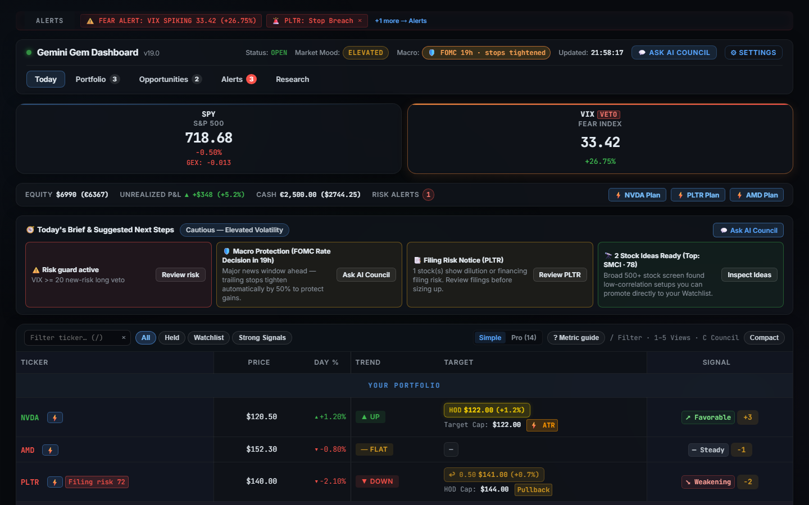
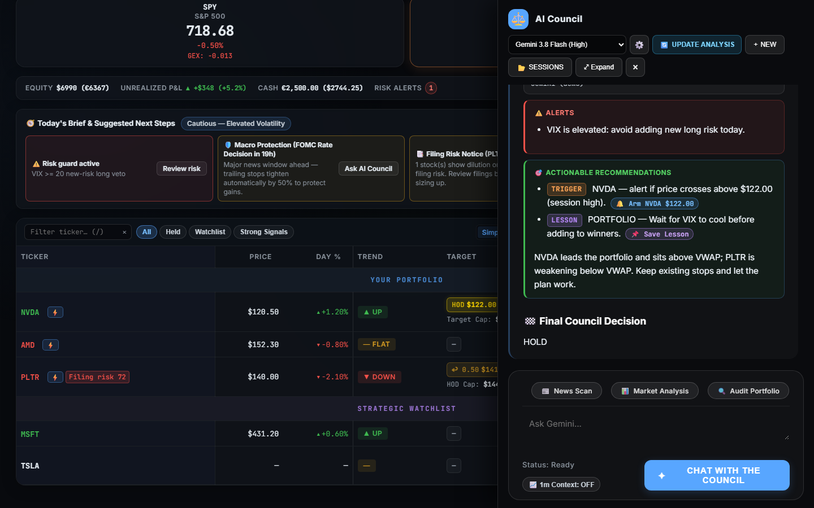
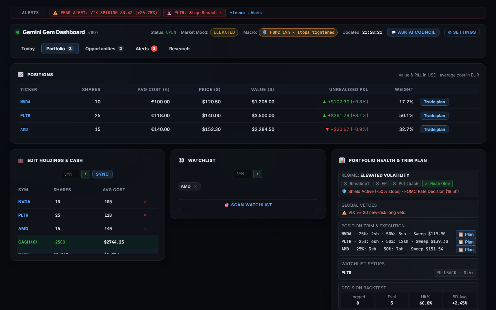
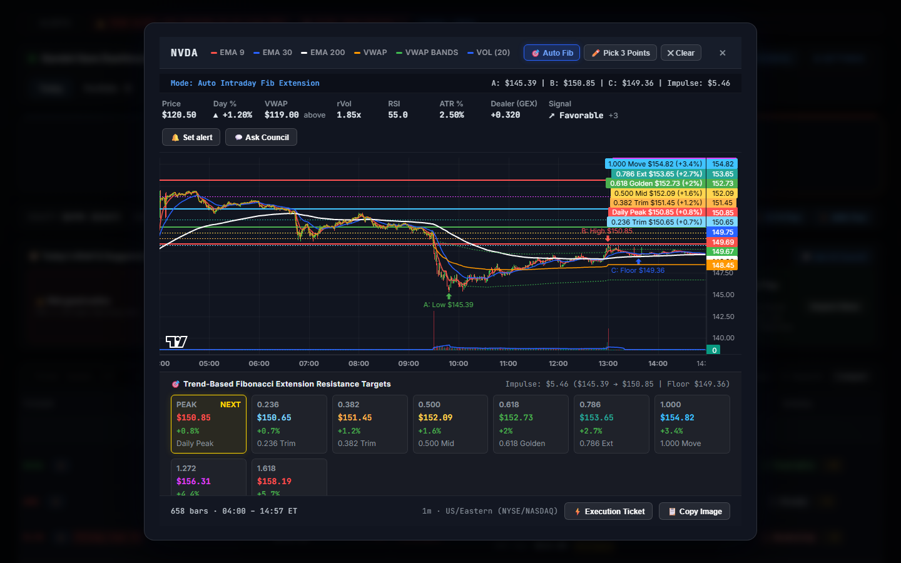

# GEM Investment Portfolio Agent Framework

**A local, human-supervised quantitative trading dashboard and multi-agent Investment Decision Council powered by deterministic Python analytics, local Antigravity App Agents (`agy.exe`), and optional Google Colab MCP GPU compute.**

Repository: [`nordicirish/gemini_cli_subagent_system`](https://github.com/nordicirish/gemini_cli_subagent_system)

---

## Showcase

<p align="center">
  
  
</p>
<p align="center">
  
  
</p>

<sub>Screenshots use demo data. See the <a href="docs/USER_GUIDE.md">User Guide</a> for a walkthrough.</sub>

---

## Architecture Overview

GEM combines fast, deterministic Python market analytics on loopback `127.0.0.1:8000` with structured multi-agent deliberation routed through the local Antigravity desktop runtime (`agy.exe`) and zero-secret asynchronous GPU offload via Google Colab MCP:

```
┌─────────────────────────────────────────────────────────────────────────┐
│                FastAPI Server & Dashboard (127.0.0.1:8000)              │
│                        python/web_server.py                             │
├─────────────────────────────────┬───────────────────────────────────────┤
│   Market Data & Quant Engines   │      Investment Decision Council      │
│  (python/fetch_stocks.py, <1ms) │  (agent_framework.py -> agy.exe CLI)  │
│  • analytics_engine.py          │  • Read-only tools + 90 KB compaction │
│  • peak_predictor.py (60d zones)│  • Bounded ThreadPool batch dispatch  │
│  • sec_edgar.py (72h filings)   │  • Owner-gated proposals (never direct│
│  • macro_calendar.py (ENH_259)  │    autonomous writes to SSoT/rules)   │
│  • merton_optimizer.py          │  • read_colab_quant_signals() reader  │
│  • decision_backtester.py       │                                       │
│  • alert_monitor / sentinel     │  SQLite + PersistenceService -> SSoT  │
├─────────────────────────────────┴───────────────────────────────────────┤
│               Google Colab MCP Offload (Zero-Secret Egress)             │
│         python/colab_mcp_client.py · colab_jobs.py · workers            │
│  • Stdio (`uvx googlecolab/colab-mcp`) or Hosted HTTP MCP + Offline JSON│
│  • Vol Surface (#4) · Quant Scout 500+ (#5) · SEC NLP (#3) · Backtest #2│
└─────────────────────────────────────────────────────────────────────────┘
```

### Key Architectural Guarantees
- **Pure Antigravity Council Execution:** Prompts run locally through `agy.exe` (`python/agent_framework.py`) with `MAX_AGY_STDIN_BYTES = 90_000` compaction, model routing from `config.json` (e.g., `gemini-4-argon-high`, `gemini-4-hydrogen-high`, `gemini-4-neon-high` via `/api/list_models`), and SSoT halt-veto guards (`_is_halted_execution_payload`).
- **Deterministic Local Analytics:** Quantitative regime classification, 60-day intraday peak timing (`peak_predictor.py`), SEC 72h dilution checks (`sec_edgar.py`), Tier-1 macro shield (`macro_calendar.py`), Merton sizing (`merton_optimizer.py`), and decision backtesting (`decision_backtester.py`) run in-process without LLM round-trips.
- **SQLite + Atomic SSoT Persistence (`python/persistence/`, `python/database/`):** Enforces 28-digit `Decimal` precision, rejects invalid holdings (`shares > 0, wac == 0` -> HTTP `422`), and projects state deterministically to `context/ssot.json`.
- **Protocol 06 Protected Assets:** `gem_trading_rules/rules.md`, `engine_instructions/*.md`, and `context/*` (`ssot.json`, `trade_lessons.json`, `decision_log.json`, `config.json`) can never be autonomously mutated by agents or Colab artifacts.

---

## Quick Start

### Prerequisites
- **Python 3.10+** (project virtual environment in `.venv`)
- **Node.js 18+** (for frontend JS/DOM tests under `tests/js/`)
- **Google Antigravity Desktop (`agy.exe`)** for local Council execution
- *(Optional)* Google Colab MCP transport (`uvx googlecolab/colab-mcp` on PATH or Colaboratory OAuth bearer token)
- *(Optional)* Market data API keys (`FINNHUB_API_KEY`, `POLYGON_API_KEY`, `ALPHA_ADVANTAGE_API_KEY`)

### Setup & Launch (Windows PowerShell 5.1)

```powershell
# 1. Clone and enter workspace
git clone https://github.com/nordicirish/gemini_cli_subagent_system
cd gemini_cli_subagent_system

# 2. Install Python dependencies (and Antigravity sidecar config if desired)
powershell -ExecutionPolicy Bypass -File install.ps1
# Or manually:
.\.venv\Scripts\python.exe -m pip install -r requirements.txt
npm install

# 3. Start the web dashboard & background market data daemon (127.0.0.1:8000)
.\.venv\Scripts\python.exe python/web_server.py

# Alternative: Launch interactive terminal loop
.\.venv\Scripts\python.exe python/main.py

# Alternative: Launch embedded in Antigravity Sidecar
.\.venv\Scripts\python.exe scripts/launch_sidecar.py
```

Open **`http://127.0.0.1:8000`** in your browser.

---

## Dashboard UI Guide

Five client-side workspace views (vanilla JS view switching; every panel keeps its element IDs and keeps polling while hidden). Deep-linkable via `#portfolio`, `#opportunities`, `#alerts`, `#research`.

1. **Today (default):** stationary alert bar (top 2 by severity + `+N more → Alerts`, hidden when empty), macro cards, Portfolio Command Strip (Equity / P&L / Cash / risk guards / per-holding plans), plain-English **Today's Brief** with deep-link actions, and the **14-column market table** (`#data-table`):
   - **Simple** (6 columns) / **Pro (14)** toggle with CSS column-group dividers, `? Metric guide` popover, All / Held / Watchlist / Strong Signals filters, live search (`/`), per-section sorting (incl. MACD, Target distance, Dealer (GEX)), compact density.
   - Honest data states: unscanned rows render `—` (never synthetic 0 / 50.0 / EUR cost as USD); `rVol` gated on `volume > 0`; backend `0.0` "no GEX" placeholder renders `—`.
   - Rows are keyboard-focusable; the 3s refresh skips identical markup and restores focus.
   - Clicking a row opens the 1-minute Lightweight Chart modal with the **Stock Inspector** strip (Price, Day %, VWAP side, rVol, RSI, ATR %, Dealer (GEX), Signal + **Set alert** / **Ask Council**), auto/3-point Fib HUD, and Execution Ticket link.
2. **Portfolio:** read-only **Positions** table from `/api/analytics` (shares, EUR avg cost, USD price/value, unrealized P&L, weight, Trade plan), holdings & cash editor with draft-row protection, watchlist with **🎯 Scan Watchlist**, and **Portfolio health & trim plan** (strategy permissibility, risk guards, tranches, decision backtest).
3. **Opportunities:** Colab **Stock Finder (500+)** with `📊 Top 20+ Table` rankings modal and `+ Watch`, plus **Sector Themes** scouting.
4. **Alerts:** full active-alert list with acknowledge, price/indicator trigger quick-add, and **Auto-tune alerts** (AlertSentinel; engine selector under *Engine settings*).
5. **Research:** Google Colab cloud research (**▶ Refresh All Cloud Insights**, Options Flow / Filing Risk / Strategy Check), read-only **Suggested Rule Tweaks** evidence pack with `📋 Copy Proposal`, and **Offline Colab Calibration (JSON)**.
- **⚙ Settings popover:** Manage tracked indices; Clear decision log (in-page confirmation).
- **AI Council (`c`):** docked, non-modal 560px co-pilot panel with **⤢ Expand** full-screen toggle; streaming SSE deliberation (`DOMPurify` + `marked` sanitized), quick-prompt chips, read-only `/api/review`, owner-approved proposal cards, 1-click `[LESSON]` / `[TRIGGER]` actions, and verdicts labelled **AI Advisory** (never an executed order).

Trader-facing UI never shows internal rule IDs (`ENH_*`, `MANDATE_*`); they remain in LLM-bound text only. Type scale has a 12px floor, motion honours `prefers-reduced-motion`, and native `alert()`/`confirm()` are replaced by accessible in-page dialogs.

### Keyboard Shortcuts
- `1`–`5` — Switch view (Today, Portfolio, Opportunities, Alerts, Research)
- `/` — Focus market table ticker filter
- `c` — Toggle the AI Council panel
- `Tab` / `Enter` — Focus rows & sortable headers; Enter opens a chart or sorts
- `Esc` — Close the active chart, ticket, popover, or dialog
- `Enter` / `Shift + Enter` (in chat input) — Send message / insert newline

---

## Google Colab MCP Integration

Heavy cross-sectional and NLP computations can run on Colab GPUs via **Model Context Protocol (`mcp==2.3.0`)** or offline JSON round-tripping:

### Transport Modes (`python/colab_mcp_client.py`)
| Environment Variable | Default | Purpose |
|---|---|---|
| `COLAB_MCP_MODE` | `cli` *(when `colab` installed, else `stdio`)* | `cli` (headless `google-colab-cli`), `stdio` (`uvx googlecolab/colab-mcp`), `http` (hosted endpoint), or `offline` |
| `COLAB_CLI_PATH` | *(auto-discovered)* | Path to `google-colab-cli` (`colab.exe` / `colab`) when not on `PATH` |
| `COLAB_CLI_AUTH` | *(CLI default)* | Optional auth strategy (`oauth2` or `adc`) passed as `--auth` to `colab` |
| `COLAB_MCP_COMMAND` | `uvx` | Stdio executable for local MCP bridge |
| `COLAB_MCP_ARGS` | `["git+https://github.com/googlecolab/colab-mcp"]` | Args for stdio MCP bridge |
| `COLAB_MCP_URL` | `https://colaboratory.googleapis.com/mcp` | Hosted Colab MCP endpoint (`http` mode) |
| `COLAB_MCP_BEARER_TOKEN` | *(empty)* | OAuth bearer token required when `COLAB_MCP_MODE=http` |
| `COLAB_MCP_TIMEOUT_SEC` | `600` | Per-job timeout in seconds |
| `COLAB_AUTO_RUN_ON_STARTUP` | `0` | Set `1` to auto-run missing/stale Colab jobs on server startup (default: run manually via **▶ Refresh All Cloud Insights**) |
| `COLAB_MCP_PERSISTENT_SESSION` | `1` | Keeps one `colab-mcp` process + linked Colab browser tab for the whole server run in `stdio` mode (`0` = fresh session per run) |

### Headless CLI, Browser Handshake & Offline Fallback
- **Headless CLI (`mode="cli"`):** When `google-colab-cli` is installed (and authorized once via `colab sessions`), each job runs via ephemeral `colab run --config <temp> --timeout 600 [--gpu T4|L4] <script>` — no browser tab required, strict GPU allowlist (`CPU`, `T4`, `L4`), and every remote VM self-terminates on completion or error.
- **Browser Fallback (`mode="stdio"`):** Launches `uvx googlecolab/colab-mcp` and invokes `open_colab_browser_connection` if execution tools aren't unlocked yet.
- **Outbound Bundle (`export_colab_bundle`):** Strips all API keys, personal cash balances, share counts, and cost basis — only public ticker lists, market aggregates, and OHLCV/rule metadata leave localhost.
- **Worker Suite (`python/colab_workers/`):**
  - `vol_surface_greeks.py` (Worker #4 — multi-expiry IV surface, Vanna/Charm tags)
  - `quant_scout_screener.py` (Worker #5 — 500+ ticker quantitative screen)
  - `sec_nlp_analyzer.py` (Worker #3 — FinBERT + optional L4 7B dilution/catalyst NLP)
  - `walk_forward_backtester.py` (Worker #2 — OOS parameter sensitivity & rule evidence)
- **Fail-Closed Ingestion:** Results pass strict Pydantic/schema validation (`python/colab_calibration.py`) before caching to `cache/colab_*.json`. Council agents inspect signals strictly read-only via `read_colab_quant_signals()`, and walk-forward rule proposals require explicit Owner approval.

---

## REST API Reference (`python/web_server.py` & `python/fetch_stocks.py`)

### Market Data, Portfolio & Watchlist
| Endpoint | Method | Purpose |
|---|---|---|
| `/api/data` | `GET` | Live ticker quotes, indicators, precomputed analytics & status snapshot |
| `/api/tickers` | `GET` | Tracked portfolio, watchlist & macro symbols + `MACRO_LABELS` |
| `/api/intraday/{symbol}` | `GET` | 1m extended-hours OHLCV bars and EMA-200 warmup closes |
| `/api/macro` | `POST` | Update tracked macro benchmark symbols |
| `/api/basket` | `GET` / `POST` | Read or persist portfolio holdings & EUR/USD cash reserves (HTTP 422 on invalid WAC) |
| `/api/watchlist` | `GET` / `POST` | Read or update monitored watchlist symbols |
| `/api/paste` | `POST` | Parse & ingest pasted manual payload updates |

### Council Chat, Proposals, Trade Lessons & Settings
| Endpoint | Method | Purpose |
|---|---|---|
| `/api/chat` | `POST` | SSE streaming Council deliberation (stages execution payloads as proposals) |
| `/api/cancel_chat` | `POST` | Cancel active Council generation turn |
| `/api/reset_chat` | `POST` | Reset active chat session history |
| `/api/review` | `POST` | Read-only Post-Trade Review audit against decision log |
| `/api/prompts/boot` · `snapshot` · `news_scan` | `GET` | Generate structured boot, snapshot, or news scan prompts |
| `/api/list_models` | `GET` | List configured Antigravity models |
| `/api/set_model` · `/api/set_cache_policy` | `POST` | Switch active orchestrator model or context policy |
| `/api/proposals` · `/{id}/apply` · `/{id}/discard` | `GET` / `POST` | Manage owner-gated portfolio proposals |
| `/api/improvements` · `/{id}/apply` · `/{id}/discard` | `GET` / `POST` | Manage owner-approved rule improvement proposals |
| `/api/save_decision_log` · `/api/clear_decision_log` | `POST` | Append or clear decision log records |
| `/api/trade_lessons/add` | `POST` | Append a codified trade lesson entry |
| `/api/get_settings` · `/api/save_settings` | `GET` / `POST` | Read/write persistent dashboard settings |
| `/api/system_logs` | `GET` | SSE stream of redacted backend operational logs |

### Discovery, Alerts, Analytics & Colab MCP
| Endpoint | Method | Purpose |
|---|---|---|
| `/api/ai_scout` | `POST` | Trigger Sector AI discovery or Watchlist rescan |
| `/api/scout_categories` · `/api/scout_sectors` · `/api/scout_config` | `GET` / `POST` | Manage active sectors, RSI ceiling, and result cap |
| `/api/alerts` · `/{rule_id}` · `/toggle` · `/events/*` | `GET` / `POST` / `DELETE` | Manage price/indicator trigger rules and alert events |
| `/api/alert_sentinel` · `/config` · `/run` | `GET` / `POST` | Read, configure, or trigger Low-Power Sentinel cycles |
| `/api/analytics` · `/backtest` · `/execution` · `/calendar` | `GET` | Deterministic regime, backtest, execution risk & macro calendar payloads |
| `/api/analytics/sec/{ticker}` · `/peak/{ticker}` | `GET` | SEC 72h dilution radar & 60d intraday peak prediction for ticker |
| `/api/calibration/export` · `/import` · `/status` | `GET` / `POST` | Export zero-secret bundle, import offline calibration JSON, or inspect status |
| `/api/colab/status` | `GET` | Transport readiness, startup/manual pipeline progress & artifact freshness |
| `/api/colab/jobs/run_all` | `POST` | Launch sequential 4-step Colab pipeline (`vol_surface`, `sec_nlp`, `quant_scout`, `walk_forward`) |
| `/api/colab/jobs/{job_type}` · `/api/colab/jobs/{job_id}` | `POST` / `GET` | Launch or poll single-flight Colab MCP jobs (`vol_surface`, `quant_scout`, `sec_nlp`, `walk_forward`) |
| `/api/colab/artifacts/{artifact_type}` · `/import` | `GET` / `POST` | Inspect or manually import validated Schema v2.0 Colab artifacts |

---

## Testing, Security & Governance Verification

All tests use Python stdlib `unittest` (`pytest` is never used) and Node's built-in test runner (`node --test`):

```powershell
# Run JS dashboard & XSS sanitizer tests
node --test tests/js/dashboard_load.test.js tests/js/sanitize_chat_html.test.js

# Run scoped verification stage gate (auto-routes affected Python & JS suites + hygiene + Protocol 06 + user-doc parity)
.\.venv\Scripts\python.exe scripts/stage_gate.py --scoped

# Run static security & secret audit
.\.venv\Scripts\python.exe scripts/audit_security.py

# Verify role manifest parity (docs/agents/roles.json -> .agents/ & .claude/)
.\.venv\Scripts\python.exe scripts/sync_agent_manifests.py --check
```

- **Plain-English User Guide:** See [`docs/USER_GUIDE.md`](docs/USER_GUIDE.md) (maintained by the `documentation-subagent`).
- **Governance Rules:** See [`.agents/AGENTS.md`](.agents/AGENTS.md), [`INSTRUCTIONS.md`](INSTRUCTIONS.md), and [`docs/governance/project-state.md`](docs/governance/project-state.md).
- **Release History:** See [`CHANGELOG.md`](CHANGELOG.md).
