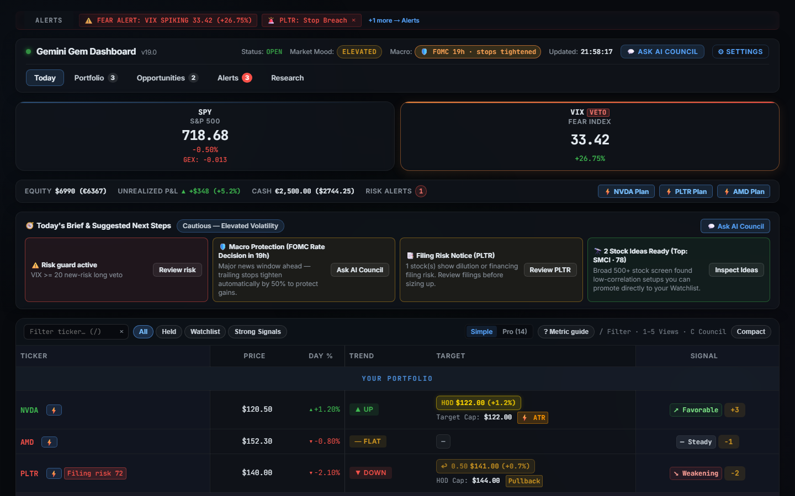
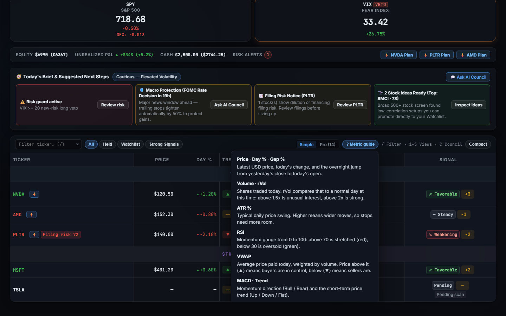
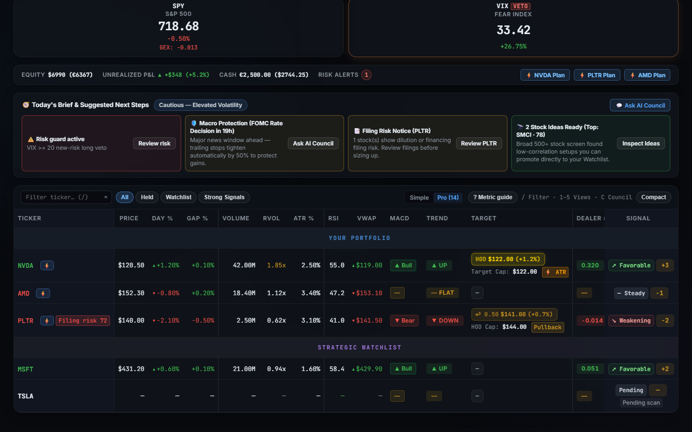
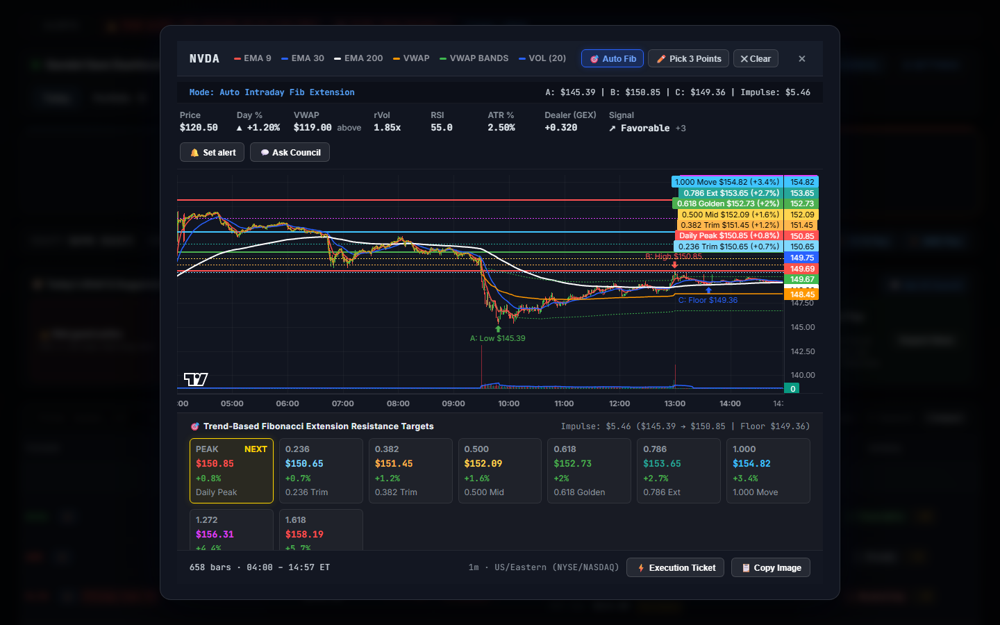
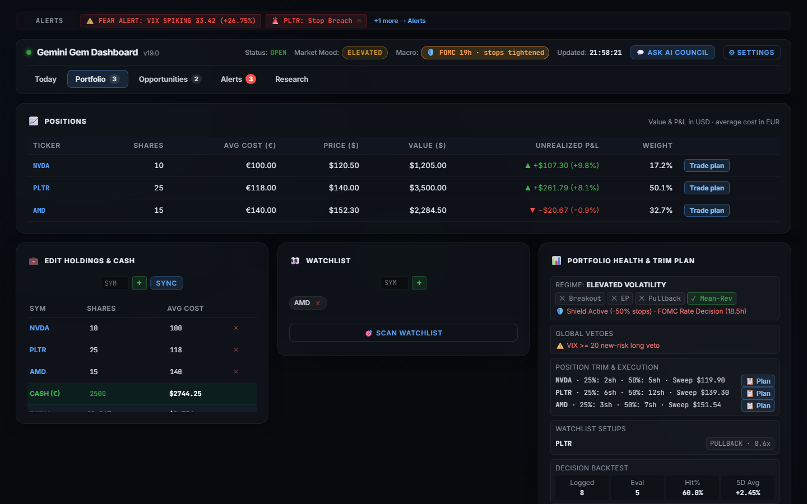
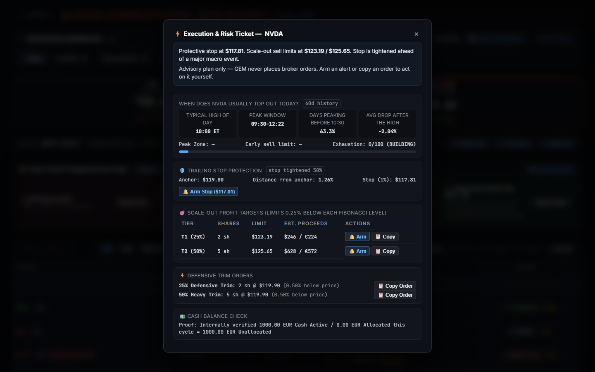
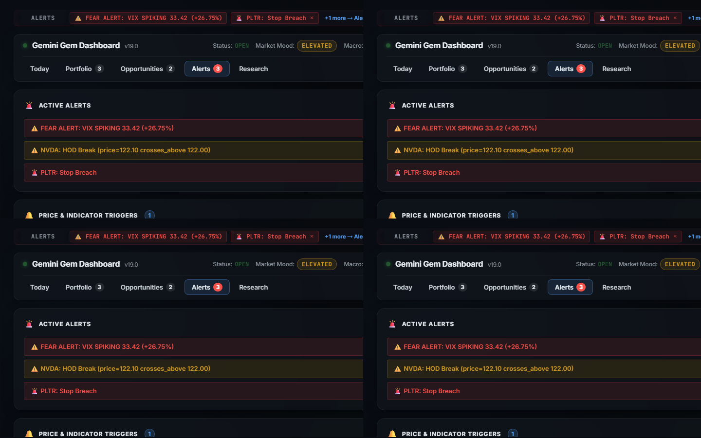
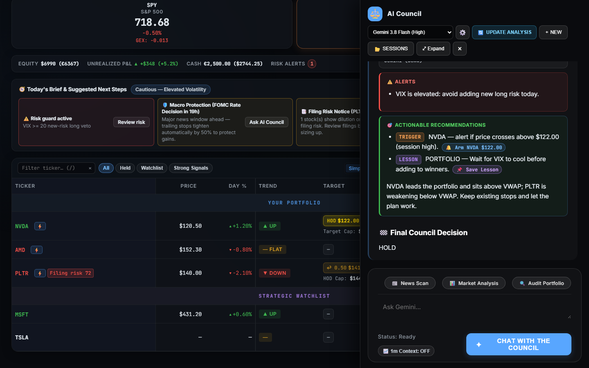
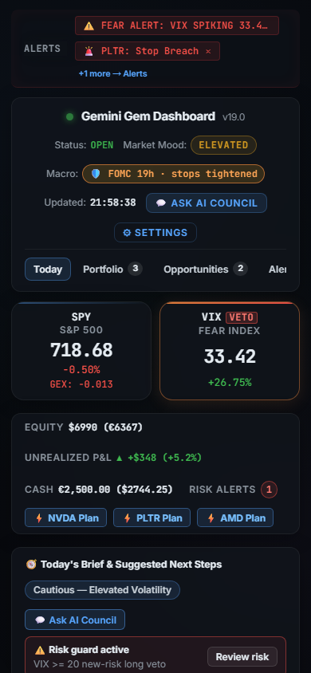

# GEM Dashboard — Plain-English User Guide

Welcome! This guide explains how to use the dashboard without options-desk jargon or developer setup details. Every number and suggestion comes from local deterministic analytics and optional Google Colab research, and **nothing ever changes your trading rules or portfolio — or places a broker order — without your click**.

> Screenshots in this guide use demo data (a fictional NVDA / PLTR / AMD portfolio), not real holdings.

---

## 1. Finding Your Way Around

The dashboard has five views. Switch with the tabs under the header or press **`1`–`5`**:

| View | What lives there |
|---|---|
| **Today** (`1`) | Market overview cards, your portfolio summary, **Today's Brief**, and the live stock table |
| **Portfolio** (`2`) | Positions with value & P&L, holdings/cash editor, watchlist, portfolio health & trim plan |
| **Opportunities** (`3`) | Stock Finder (500+ stocks) and Sector Themes |
| **Alerts** (`4`) | Every active alert, your price/indicator triggers, and automatic trigger tuning |
| **Research** (`5`) | Google Colab cloud research and strategy evidence |

Badges on the tabs show counts (holdings, stock ideas, active alerts). Links like `http://127.0.0.1:8000/#portfolio` open a view directly.

**⚙ Settings** (top right) holds *Manage tracked indices* and *Clear decision log*.

---

## 2. Quick Daily Workflow (1 Minute)

1. Open **`http://127.0.0.1:8000`** — you land on **Today**.
2. Check the **alert bar** at the very top. It shows the two most serious alerts and a **+N more → Alerts** link; it disappears when nothing needs attention.
3. Glance at **Market Mood** (e.g. `Elevated`, `Bearish · Volatile`) and the **Macro** pill, which warns before big releases (Fed decisions, jobs report, CPI) and notes when stops are tightened for them.
4. Read **🧭 Today's Brief** — up to four plain-English cards (risk guards, macro protection, filing risk, stretched holdings, new stock ideas). Each card's button takes you straight to the right place, e.g. **Review risk** opens the Portfolio view.
5. Scan the stock table (below).

---

## 3. The Stock Table

- **Simple** view shows 6 columns: Ticker, Price, Day %, Trend, Target, and **Signal** (`▲ Strong Setup`, `↗ Favorable`, `— Steady`, `↘ Weakening`, `▼ High Risk`, or `🔥 Overheated` plus a score from −6 to +6).
- **Pro (14)** adds Gap %, Volume, rVol, ATR %, RSI, VWAP, MACD and **Dealer (GEX)**. Thin dividers group the columns into *Price & Session · Activity · Technicals · Options & Signal*.
- Not sure what a column means? Click **? Metric guide** for a one-sentence explanation of each.
- Filter with the search box (`/`) or the **All / Held / Watchlist / Strong Signals** pills. Click a column header (or Tab to it and press Enter) to sort — MACD, Target (by distance) and Dealer (GEX) sort too.
- **`—` means "no data yet"** (still scanning, or no source). GEM never fills gaps with made-up numbers, and it never shows your EUR cost as a USD price.

---

## 4. Stock Inspector & Charts

Click any row (or Tab to it and press **Enter**) to open the 1-minute chart. The **Stock Inspector** strip above the chart shows Price, Day %, VWAP (above/below), rVol, RSI, ATR %, Dealer (GEX) and Signal in one place — handy in Simple view. Hover any value for a plain-English hint.

- **🔔 Set alert** opens the Alerts view with the ticker and current price already filled in.
- **💬 Ask Council** opens the AI Council with a ready-to-send question about that stock.
- **⚡ Execution Ticket** (held stocks) and **📋 Copy Image** sit at the bottom.

---

## 5. Portfolio & Exit Plans

The **Portfolio** view shows a **Positions** table — shares, average cost (€), live price, value and unrealized P&L ($), and each holding's weight — with a **Trade plan** button per row. If a holding has no live price yet it shows `—` rather than an estimate.

- **Edit holdings & cash:** add symbols, enter shares and average cost in EUR, then **SYNC**. Unsaved rows are protected while you edit.
- **Watchlist:** add stocks you are considering; **🎯 Scan Watchlist** forces a fresh signal check.
- **Portfolio health & trim plan:** which strategies suit the current market, active risk guards, trim sizes, and your decision backtest hit rate.

**Trade plans (Execution Ticket)** open from **Trade plan**, the `⚡` on a held row, the summary bar, or the chart. Each starts with a one-line summary (*"Protective stop at $X. Scale-out sell limits at $Y / $Z."*), then shows the trailing stop, profit-taking limits (set 0.25% below each Fibonacci level), defensive trims (0.50% below price), the typical time the stock tops out, and a cash balance check. Use **🔔 Arm** to set an alert or **📋 Copy** to copy an order — **GEM never places broker orders**.

---

## 6. Finding New Stocks (**Opportunities**)

1. **Stock Finder (500+):** screens 500+ individual stocks (no indices, VIX products or macro ETFs) for strong momentum and low correlation to what you already hold. Click **📊 Top 20+ Table** for the full ranked list with sector filter and search, and **+ Watch** to add a pick to your watchlist.
2. **Sector Themes:** choose sectors (e.g. Semiconductors, Biotech), set max RSI and max picks, then **🔭 Scout New Sectors**.

---

## 7. Alerts

The **Alerts** view lists every active alert in a readable, stationary list — acknowledge each with **×** once reviewed. Below it you can arm **price & indicator triggers** (ticker, metric, condition, level) and turn on **⚡ Auto-tune alerts**, which re-tunes triggers to current price levels on a schedule (default engine: local rules, no AI). Advanced engine choices are tucked under **Engine settings**.

---

## 8. Cloud Research (**Research**)

- Click **▶ Refresh All Cloud Insights** to run four Google Colab steps with live progress: **⚡ Options Flow**, **📑 Filing Risk**, **🔭 Stock Finder**, and **📊 Strategy Check**. (It no longer starts automatically — set `COLAB_AUTO_RUN_ON_STARTUP=1` if you want that.)
- The status pill shows **Cloud: Ready** or **Cloud: Setup needed**; one-time setup steps are under a collapsed *show steps* section.
- **Deeper AI review of filings** (checkbox) adds an *advisory* plain-English read of each stock's SEC filings from an open-weight model (Qwen2.5-7B) running on a Colab L4 GPU. It appears in the **Filing risk** badge tooltip and the Stock Inspector as *"AI filing read (advisory)"*. It never changes the filing risk score; when the AI and the rule-based score differ by more than 30 points you'll see **⚠ Models disagree — read the filing**. If no suitable GPU is available, the scan runs without it and says so.
- **Suggested Rule Tweaks** are read-only until you approve them. **Offline Colab Calibration (JSON)** lets you export/import results without a live connection.

---

## 9. Consulting the AI Council

Click **💬 Ask AI Council** (or press `C`). The Council opens as a **side panel**, so you can keep using the table, charts and views while you read. Click **⤢ Expand** for a full-screen reading view (GEM remembers your choice).

- Use the quick-prompt chips or ask in plain English.
- Every verdict is labelled **AI Advisory** (e.g. *AI Advisory: Hold*) with *"Advisory only — no order placed"*.
- Suggested portfolio or rule changes appear as **Proposal Cards** you can inspect, edit, **Apply**, or **Discard** — nothing changes automatically.
- Reloading the page keeps your current conversation; opening a new browser session archives it under **SESSIONS** and starts fresh.

---

## 10. On Your Phone

Every view works on a phone: the tabs scroll sideways, and wide tables scroll inside their cards.

---

## 11. Keyboard Shortcuts

- `1`–`5` — Switch view (Today, Portfolio, Opportunities, Alerts, Research)
- `/` — Focus the table filter
- `C` — Open/close the AI Council
- `Tab` / `Enter` — Move through table rows and sortable headers; Enter opens a chart or sorts
- `Esc` — Close the open chart, ticket, popover or dialog
- `Enter` / `Shift + Enter` — Send chat message / new line

Animations are switched off automatically if your system is set to reduce motion.
