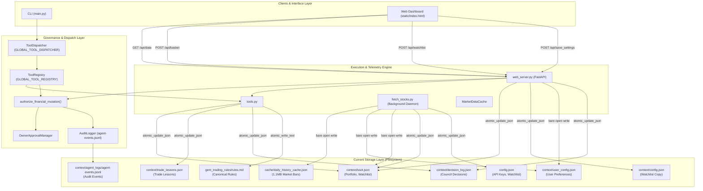
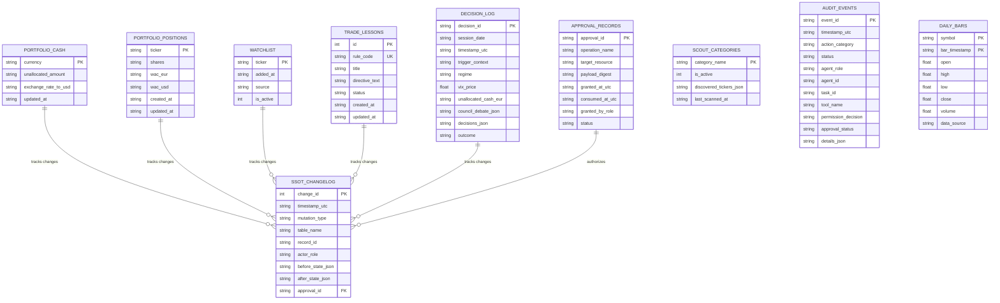
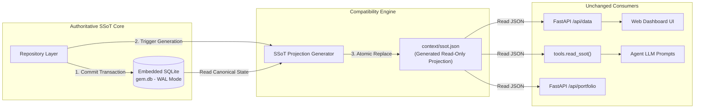
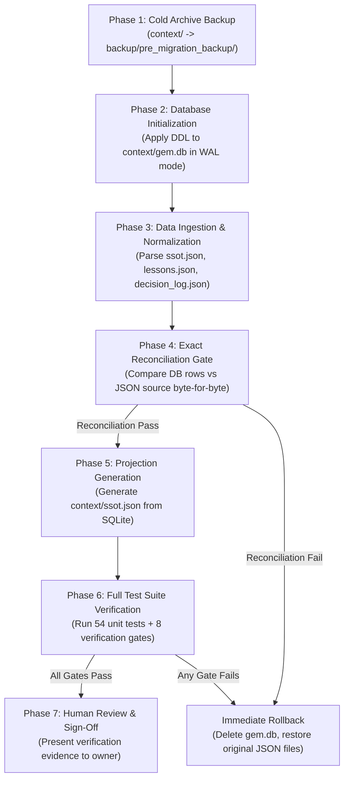

# Stage 1.2 — Embedded SQLite Persistence Architecture: Feasibility, Schema & Migration Assessment

**Repository:** `nordicirish/gemini_cli_subagent_system`  
**Branch:** `main`  
**Assessment Baseline Commit:** `fd7b00159b1b843547983794e3ec8a2264091ca4`  
**Stage:** 1.2  
**Mode:** READ-ONLY ARCHITECTURE ASSESSMENT  
**Execution Environment:** Local, single-user, human-supervised Python 3.13.3 / Antigravity CLI (`agy.exe`) application  
**Date:** 2026-11-08  
**Author:** Architecture Agent & Python Engineer  
**Standard:** Agent Governance Framework (`.agents/AGENTS.md`, Protocols 01–06)

---

## 1. Executive Summary

This document presents a comprehensive, evidence-based architectural assessment of introducing an embedded SQLite database using Write-Ahead Logging (WAL) into the GEM (Global Equity Momentum) application. The assessment was performed in a strictly read-only mode on the baseline commit `fd7b00159b1b843547983794e3ec8a2264091ca4`. No application code, configuration files, trading rules, engine instructions, tests, or state files were modified; no database files were created; and no packages were installed.

### Core Findings
1. **Existing Architecture Vulnerability:** GEM currently persists its mutable runtime state across six disconnected JSON and JSONL files (`context/ssot.json`, `context/trade_lessons.json`, `context/decision_log.json`, `context/config.json`, `context/user_config.json`, and `cache/daily_history_cache.json`). Cross-entity updates (such as executing an order that modifies portfolio holdings in `ssot.json`, records a heuristic rule in `trade_lessons.json`, and updates the watchlist in `config.json`) execute as sequential file updates without multi-file transactional boundaries or rollback capabilities.
2. **Schema Fragmentation & Redundancy:** Inspection of `context/ssot.json` and its callers revealed that three competing schemas coexist simultaneously (`mutable_state`, flat root-level keys, and `EXECUTION_PAYLOAD`), requiring defensive triple-writes in [`python/web_server.py`](file:///c:/github/gemini_cli_subagent_system/python/web_server.py#L1086-L1099) and fallback cascades in [`python/fetch_stocks.py`](file:///c:/github/gemini_cli_subagent_system/python/fetch_stocks.py#L439-L457).
3. **Monolithic Cache Overhead:** `cache/daily_history_cache.json` is a monolithic 1.10 MB JSON blob that is rewritten in its entirety on periodic market data cycles, creating severe I/O amplification and recurring file-truncation risks during unexpected task terminations.
4. **SQLite Suitability by Domain:** Embedded SQLite with WAL mode (`PRAGMA journal_mode = WAL;`) is extraordinarily well-suited for structured financial state (`portfolio_positions`, `portfolio_cash`, `watchlist`, `scout_categories`), historical decision logging (`decision_log`), codified rules (`trade_lessons`), and market time-series caching (`daily_bars`). Conversely, narrative trading rules ([`gem_trading_rules/rules.md`](file:///c:/github/gemini_cli_subagent_system/gem_trading_rules/rules.md)) and specialist engine prompts ([`engine_instructions/*.md`](file:///c:/github/gemini_cli_subagent_system/engine_instructions)) MUST remain human-readable Markdown files. Raw append-only audit streaming is best maintained as dual append-only JSONL plus an indexed SQLite mirror.
5. **Zero-Drift Compatibility via Hybrid Projections:** A backward-compatible hybrid model—where SQLite acts as the sole authoritative persistence engine and automatically generates a read-only `context/ssot.json` projection—guarantees that legacy agent tools (`tools.read_ssot()`), web endpoints (`/api/data`), and frontend dashboards continue operating without disruption or frontend contract changes.
6. **Rust Evaluation:** Evaluation of introducing Rust (`rusqlite`, `PyO3`) determined that the host environment lacks Rust toolchains and that microsecond query savings are negligible compared to network latencies (500ms) and LLM inference times (2–5s). Python's standard library `sqlite3` (wrapping SQLite C library 3.49.1) is robust, native, zero-dependency, and completely sufficient.

### Final Recommendation
**PROCEED WITH CONDITIONS** to a phased implementation stage (Stage 1.3). The conditions require preserving exact financial calculation semantics, enforcing `authorize_financial_mutation()` at the repository layer, maintaining exact decimal precision for monetary amounts, and retaining `context/ssot.json` as a generated compatibility projection.

---

## 2. Verified Baseline and Repository Status

Before conducting the architectural inspection, the repository state was formally verified against the required baseline:

- **Repository Identity:** `nordicirish/gemini_cli_subagent_system`
- **Active Branch:** `main`
- **Verified Git HEAD:** `fd7b00159b1b843547983794e3ec8a2264091ca4`
- **Baseline Integrity:** `HEAD` matches the assessment baseline commit exactly.
- **Working Tree Status:** Clean (0 modified files, 0 staged changes, 0 untracked files prior to this assessment document).
- **Python Runtime Environment:** Python 3.13.3 (MSC v.1943 64-bit AMD64, Windows 11).
- **SQLite Engine Version:** SQLite 3.49.1 (bundled in Python 3.13 standard library `sqlite3`; module version 2.6.0).
- **Installed Database Packages:** `peewee==4.5.3` is declared in [`requirements.txt`](file:///c:/github/gemini_cli_subagent_system/requirements.txt#L26) and present in `.venv`, but is currently completely unimported and unused across the codebase. SQLAlchemy and aiosqlite are not installed.
- **Rust Toolchain Status:** Not installed (`rustc` and `cargo` are absent from the host system environment).

---

## 3. Comprehensive Persistence Inventory

Every persistent data artifact within the repository was inspected, measured, and categorized by domain, format, access frequency, concurrency controls, and financial criticality.

| File / Path | Data Domain | Current Format | Readers (Modules & Functions) | Writers (Modules & Functions) | Write Frequency | Data Size | Concurrency Control | Financial Significance | Migration Suitability |
|---|---|---|---|---|---|---|---|---|---|
| [`context/ssot.json`](file:///c:/github/gemini_cli_subagent_system/context/ssot.json) | Portfolio holdings, watched tickers, cash, state context | JSON (nested & flat) | `tools.read_ssot`, `fetch_stocks.get_ssot_json_payload`, `fetch_stocks._load_ssot_tickers`, `fetch_stocks.run_daemon`, `web_server.get_portfolio`, `web_server.get_macro_telemetry`, `web_server.get_watchlist`, `main.py` | `tools.update_ssot`, `fetch_stocks.save_basket`, `fetch_stocks.save_watch_list`, `fetch_stocks.handle_paste`, `fetch_stocks.reconcile_ssot_format`, `web_server.save_basket`, `web_server.save_watch_list`, `web_server.save_scout_categories` | Low to Moderate (on trade paste, basket save, or watchlist change) | 219 bytes | `FileLock` (`ssot.json.lock`), `atomic_update_json` | **Critical (SSoT)** | **High (Primary Migration Target)** |
| [`context/trade_lessons.json`](file:///c:/github/gemini_cli_subagent_system/context/trade_lessons.json) | Heuristic trading lessons & risk execution directives | JSON (array of objects) | `tools.read_trade_lessons`, `web_server.get_trade_lessons`, `agent_framework.py`, `fetch_stocks.compile_master_document`, `fetch_stocks.handle_paste` | `tools.update_trade_lessons`, `fetch_stocks.handle_paste`, `web_server.save_decision_log` | Low (appended during post-trade reviews) | 11.74 KB (24 rules) | `FileLock`, `atomic_update_json` | **Important** | **High (Relational Table with Indexed Retrieval)** |
| [`context/decision_log.json`](file:///c:/github/gemini_cli_subagent_system/context/decision_log.json) | Historical Council debate transcripts, agent votes, trade states | JSON (prepended array of objects) | `tools.read_decision_log`, `web_server.get_decision_log` | `tools.intercept_and_log_decision`, `web_server.save_decision_log`, `web_server.clear_decision_log` | Moderate (on every Council evaluation cycle) | 9.69 KB (growing) | `FileLock`, `atomic_update_json`, `atomic_write_json` | **Important** | **High (Relational Table with Date/Ticker Indexes)** |
| [`context/agent_logs/agent-events.jsonl`](file:///c:/github/gemini_cli_subagent_system/context/agent_logs/agent-events.jsonl) | System audit log of tool calls, permissions, denials, mutations | JSONL (append-only) | `web_server.get_agent_events`, `scripts/verify_stage_1.py` | `audit_logger.AuditLogger.log_event` | High (on every tool call, denial, or mutation) | 37.49 KB | `FileLock` (`agent-events.jsonl.lock`) | **Critical (Governance & Audit)** | **Medium (Retain Dual: JSONL Primary + SQLite Mirror)** |
| [`cache/daily_history_cache.json`](file:///c:/github/gemini_cli_subagent_system/cache/daily_history_cache.json) | Historical 1d OHLCV bars & technical indicator cache | JSON (serialized DataFrames) | `fetch_stocks.MarketDataCache.load_from_disk` | `fetch_stocks.MarketDataCache.save_to_disk` | Moderate (periodic every 10 daemon cycles) | 1.10 MB (1,099,229 bytes) | None (direct `open('w')` overwrite) | **Important (Telemetry & Caching)** | **High (Migrate to SQLite `daily_bars` Cache DB)** |
| [`config.json`](file:///c:/github/gemini_cli_subagent_system/config.json) (Root) | System configuration, API keys, models, default watchlist | JSON | `fetch_stocks.py`, `web_server.py`, `agent_framework.py`, `main.py` | `web_server.update_config`, `fetch_stocks.save_watch_list` | Very Low (setup & manual edits) | 2.12 KB | Partial (`FileLock` on some routes) | **Important (Config & Secrets)** | **Retain as File (Environment Portability)** |
| [`context/config.json`](file:///c:/github/gemini_cli_subagent_system/context/config.json) | Duplicate watchlist & local API key placeholders | JSON | `fetch_stocks._load_ssot_tickers`, `web_server.get_watchlist` | `fetch_stocks.save_watch_list`, `fetch_stocks.py:568`, `web_server.save_watch_list` | Low | 52 bytes | `FileLock`, `atomic_update_json` | **Low (Redundant)** | **Consolidate & Retire** |
| [`context/user_config.json`](file:///c:/github/gemini_cli_subagent_system/context/user_config.json) | User UI settings (active tickers, macro selections) | JSON | `fetch_stocks._load_ssot_tickers`, `web_server.get_settings` | `web_server.save_settings`, `web_server.save_macro`, `fetch_stocks.py:260` | Low | 196 bytes | None (direct `open('w')` overwrite) | **Low** | **High (Consolidate into SQLite `user_preferences`)** |
| [`context/cloud_sync_manifest.json`](file:///c:/github/gemini_cli_subagent_system/context/cloud_sync_manifest.json) | Cloud drive sync tracking state | JSON | Legacy sync scripts | Legacy sync scripts | None (dormant) | 13.96 KB | None | **Non-Financial** | **Defer / Retain as File** |
| `context/charts/chart_{sym}_1m.png` | 1-minute intraday chart screenshots for multimodal analysis | Binary PNG | `web_server.get_chart_parts` | `fetch_stocks.py:884` | High during market hours | ~70 B to 50 KB | None | **Non-Financial (Telemetry)** | **Retain as Filesystem Artifacts** |
| [`gem_trading_rules/rules.md`](file:///c:/github/gemini_cli_subagent_system/gem_trading_rules/rules.md) | Canonical narrative trading rules (Mandates 01–54, ENH 01–262) | Markdown | `tools.read_rules`, `agent_framework.py`, `fetch_stocks.compile_master_document` | `tools.update_rules` (Owner-gated via `atomic_write_text`) | Extremely Rare (governance amendments) | 215.20 KB | `atomic_write_text`, Owner Confirmation | **Critical (Canonical Rules)** | **Retain as Markdown File** |
| [`engine_instructions/*.md`](file:///c:/github/gemini_cli_subagent_system/engine_instructions) (19 files) | System prompts for specialist trading council agents | Markdown | `agent_framework.py`, `fetch_stocks.compile_master_document` | None (human-authored governance artifacts) | Static | ~3 KB to 25 KB each | Read-only in application | **Critical (Agent Governance)** | **Retain as Markdown Files** |
| `fetch_stocks.GLOBAL_STATE` | Live tick telemetry, real-time bid/ask, Net GEX, intraday VWAP | In-memory Python Dict | `fetch_stocks.get_data` (`GET /api/data`), `fetch_stocks.run_daemon` | `fetch_stocks.run_daemon` | Continuous (every 30s) | In-memory (~500 KB) | In-memory GIL / thread updates | **Important (Real-Time UI)** | **Retain In-Memory (Do Not Route to Disk)** |

---

## 4. Current Architecture and Data-Flow Analysis

The diagram below maps the current data-flow across agents, web endpoints, tools, and persistence files:



### Analysis of Architectural Vulnerabilities

1. **Fragmented Ownership:** Multiple modules independently mutate the same data files. `context/ssot.json` is modified by [`tools.update_ssot`](file:///c:/github/gemini_cli_subagent_system/python/tools.py#L80), [`fetch_stocks.save_basket`](file:///c:/github/gemini_cli_subagent_system/python/fetch_stocks.py#L654), [`fetch_stocks.handle_paste`](file:///c:/github/gemini_cli_subagent_system/python/fetch_stocks.py#L976), [`web_server.save_basket`](file:///c:/github/gemini_cli_subagent_system/python/web_server.py#L1054), [`web_server.save_watch_list`](file:///c:/github/gemini_cli_subagent_system/python/web_server.py#L1160), and [`web_server.save_scout_categories`](file:///c:/github/gemini_cli_subagent_system/python/web_server.py#L1340).
2. **Watchlist Triplication:** The active watchlist is stored in `config.json` (`"WATCHLIST"`), duplicated in `context/config.json` (`"WATCHLIST"`), and duplicated again in `context/ssot.json` (`"watched_tickers"`). Updating the watchlist requires synchronizing three files; any failure mid-sequence leaves the files in conflicting states.
3. **Competing SSoT Structures:** In `ssot.json`, holdings are stored under `data["portfolio_snapshot"]`, `data["mutable_state"]["portfolio_snapshot"]`, and `data["EXECUTION_PAYLOAD"]["portfolio_snapshot"]`. To compensate, `web_server.py` writes to all three keys simultaneously ([`web_server.py:1086-1099`](file:///c:/github/gemini_cli_subagent_system/python/web_server.py#L1086-L1099)), while `fetch_stocks.py` implements a cascading fallback reader ([`fetch_stocks.py:439-444`](file:///c:/github/gemini_cli_subagent_system/python/fetch_stocks.py#L439-L444)).
4. **Lack of Multi-File Atomic Transactions:** When an execution payload arrives via [`fetch_stocks.handle_paste()`](file:///c:/github/gemini_cli_subagent_system/python/fetch_stocks.py#L976), the engine parses it, extracts portfolio changes, extracts trade lessons, and extracts rule mutations. It then executes three distinct atomic updates sequentially:
   - `atomic_update_json('context/ssot.json', ...)`
   - `atomic_update_json('context/trade_lessons.json', ...)`
   - `atomic_update_json(rules_file, ...)`
   If the second or third update fails or encounters an unhandled exception, the portfolio update in `ssot.json` has already been committed to disk. There is no cross-file rollback mechanism.
5. **Partial State Visibility:** Although `atomic_update_json()` uses `os.replace` to make individual file updates atomic, concurrent readers (such as the background scanning daemon or web API requests) can read `ssot.json` after step 1 but before `trade_lessons.json` is updated in step 2, observing partially applied logical states.
6. **Unprotected Direct File Writes:** While Stage 1.1 protected authoritative financial paths, non-financial configuration files are written using bare `open(..., 'w')` calls without locks or atomic replace:
   - `fetch_stocks.py:524` (clearing scout categories on startup)
   - `fetch_stocks.py:1489` (saving 1.1MB daily history cache)
   - `web_server.py:957` (saving user settings)
   - `web_server.py:997` (saving macro tickers)

---

## 5. Existing Source-of-Truth Matrix

To ensure zero ambiguity during schema design, the authoritative source of truth for every application domain was mapped:

| Financial / Application Data Domain | Authoritative Existing SSoT | Secondary / Cache Copies | Conflict Resolution Rule in Current Source |
|---|---|---|---|
| Active Portfolio Holdings & WAC | `context/ssot.json` (`portfolio_snapshot`) | `fetch_stocks.GLOBAL_STATE["local_storage_state"]` | File on disk supersedes memory; `fetch_stocks.py` re-reads disk on every cycle |
| Unallocated Cash Balances (EUR & USD) | `context/ssot.json` (`unallocated_cash_eur`, `unallocated_cash_usd`) | Memory cache, Council prompt text | Disk file values supersede prompt text |
| Active Watched Tickers | Root `config.json` (`"WATCHLIST"`) | `context/config.json`, `context/ssot.json` (`"watched_tickers"`) | `fetch_stocks.get_watch_list()` reads `config.json`, falls back to `ssot.json` |
| Active Scout Categories | `context/ssot.json` (`scout_categories`) | `config.json` (`"SCOUT_CATEGORIES"`) | Disk SSoT is authoritative, but cleared to `[]` on startup to defer heavy API calls |
| Codified Trade Lessons | `context/trade_lessons.json` (`"trade_lessons"`) | `context/trade_lessons.md` | JSON file is authoritative; MD file is generated via `scripts/convert_lessons.py` |
| AI Council Decision History | `context/decision_log.json` (`"decision_log"`) | In-memory chat history | Disk file is authoritative, prepended on every Council consensus turn |
| System Audit Trail | `context/agent_logs/agent-events.jsonl` | None | Append-only file is authoritative |
| Historical 1d OHLCV Price Bars | `cache/daily_history_cache.json` (`"history"`) | Remote Yahoo Finance / Polygon APIs | Local cache checked first; falls back to remote API on cache miss or cycle 10 |
| Real-Time Market Telemetry (Quotes/GEX) | `fetch_stocks.GLOBAL_STATE` (In-memory) | None | Purely in-memory; refreshed every 30 seconds from live API quotes |
| Canonical Trading Mandates & Rules | `gem_trading_rules/rules.md` | `scratch/master_trading_knowledge.md` | `rules.md` is strictly canonical; master document is compiled on startup |
| Specialist Engine System Prompts | `engine_instructions/*.md` (19 files) | `scratch/master_trading_knowledge.md` | Individual MD files are authoritative; never modified at runtime |
| API Credentials & Backend Settings | Root `config.json` | `context/config.json` (placeholders) | Root `config.json` is authoritative |

---

## 6. SQLite Suitability Assessment by Domain

Each application domain was evaluated independently to determine whether migration to SQLite is justified.

### 6.1 Domain-by-Domain Suitability Analysis

| Data Domain | Recommendation | Detailed Technical Justification |
|---|---|---|
| **Portfolio Positions & Cash** | **Migrate to SQLite** | Highest financial criticality. Requires atomic multi-row updates, strict check constraints (`shares >= 0`, `wac > 0`), foreign-key linkage between positions and currency cash records, and transactional rollback on failed rebalancing. |
| **Watchlist & Scout Categories** | **Migrate to SQLite** | Eliminates confusing three-way file duplication between `config.json`, `context/config.json`, and `ssot.json`. Unique constraints prevent duplicate tickers; active flags enable instantaneous filtering without file rewrites. |
| **Trade Lessons** | **Migrate to SQLite** | Structured heuristic records with unique identifiers (`L-219`, `L-230`). Relational schema enables indexed search by category, status, and keywords, reducing LLM context overhead by injecting only relevant lessons rather than reading all 24 rules into every prompt. |
| **Decision Log** | **Migrate to SQLite** | Currently prepends to an unbounded JSON list, forcing a full-file read, parse, stringify, and fsync cycle on every Council turn. In SQLite, appending is a single `INSERT` operation into an indexed table with zero file-rewrite overhead. |
| **Daily Market History (Cache)** | **Migrate to SQLite (Separate DB)** | Currently a 1.10 MB JSON blob that is rewritten in place. Storing bars in a dedicated `cache/market_data.db` SQLite database enables incremental bar upserts (`INSERT OR REPLACE`), eliminates file corruption risk, and allows fast time-series queries (e.g. `SELECT * FROM daily_bars WHERE symbol = ? ORDER BY bar_timestamp DESC LIMIT 60`). |
| **Audit Events** | **Retain Dual (JSONL Primary + SQLite Mirror)** | Raw append-only JSONL must remain the primary audit sink because it is physically isolated from database lock contention, cannot be corrupted by database engine faults, and is universally parseable by external CLI tools. A synchronous or asynchronous mirror to an SQLite `audit_events` table enables rapid querying for the web dashboard (`/api/agent_events`). |
| **Narrative Trading Rules** | **Retain as Markdown** | [`gem_trading_rules/rules.md`](file:///c:/github/gemini_cli_subagent_system/gem_trading_rules/rules.md) (215 KB) is a legalistic governance document. Storing large prose in relational tables destroys human readability, complicates Git diffing, and weakens human owner oversight. |
| **Engine Instructions** | **Retain as Markdown** | The 19 files in [`engine_instructions/`](file:///c:/github/gemini_cli_subagent_system/engine_instructions) are specialist agent system prompts. They are version-controlled in Git, inspected directly by the human owner, and read as strings into `AntigravityAgentRunner`. Moving them to a database adds operational complexity with zero architectural benefit. |
| **System Secrets & Config** | **Retain as JSON** | API keys, model parameters, and environment toggles in [`config.json`](file:///c:/github/gemini_cli_subagent_system/config.json) belong in a flat configuration file that can be edited with standard text editors and excluded from Git without database access tools. |
| **Real-Time Intraday Telemetry** | **Retain In-Memory** | Live tick updates, sub-second bid/ask quotes, and temporary WebSocket frames have zero retention value and high update frequencies. Routing them through disk transactions would degrade responsiveness. |

### 6.2 SQLite Engine Configuration Analysis

To ensure predictable behavior in a local, single-user, multi-threaded environment:

1. **Write-Ahead Logging (WAL Mode):**
   - Enabling `PRAGMA journal_mode = WAL;` is mandatory.
   - **Concurrency Semantics:** In WAL mode, SQLite supports **unlimited concurrent readers alongside one active writer**. Readers do not block writers, and writers do not block readers. This resolves the existing contention between background scanning threads and incoming HTTP read requests.
   - **Crucial Limitation:** SQLite still allows only **one active write transaction at a time**. Multi-threaded writers will queue.
2. **Busy Timeout (`PRAGMA busy_timeout = 5000;`):**
   - When a writer attempts to acquire the write lock while another thread is committing, SQLite will automatically sleep and retry for up to 5,000 milliseconds before raising `sqlite3.OperationalError: database is locked`. In a local application where write transactions take < 2ms, this guarantees zero lock timeouts under normal operation.
3. **Synchronous Mode (`PRAGMA synchronous = NORMAL;`):**
   - In WAL mode, `PRAGMA synchronous = NORMAL;` provides full ACID guarantees against application crashes and OS failures while eliminating synchronous disk flushes on every transaction commit, dramatically accelerating write throughput.
4. **Foreign Key Enforcement (`PRAGMA foreign_keys = ON;`):**
   - By default in SQLite, foreign keys are disabled for backward compatibility. Enabling them per connection is essential to maintain referential integrity between cash balances, portfolio holdings, and audit changelogs.
5. **Connection Lifecycle & Thread Safety:**
   - Standard Python `sqlite3.Connection` objects cannot be shared across threads when transactions are open. The architecture must utilize a thread-local connection pool or open short-lived connections per request with `check_same_thread=False`.
6. **WAL Checkpointing & File Growth:**
   - WAL files (`gem.db-wal`) grow until checkpointed. In a long-running application, passive checkpoints occur automatically at 1,000 pages (~4MB). The application should execute an explicit `PRAGMA wal_checkpoint(PASSIVE);` during daemon idle cycles and `PRAGMA wal_checkpoint(TRUNCATE);` on graceful shutdown to keep the database consolidated in a single primary file (`gem.db`).

---

## 7. Proposed Relational Schema and Entity-Relationship Architecture

The proposed relational schema models GEM's core financial and operational entities with strict typing, constraints, and indexes.

### 7.1 Schema DDL Specification

```sql
-- Core Database Configuration (Enforced on every connection)
PRAGMA journal_mode = WAL;
PRAGMA busy_timeout = 5000;
PRAGMA foreign_keys = ON;
PRAGMA synchronous = NORMAL;

-- ============================================================================
-- 1. PORTFOLIO & CASH DOMAIN (Authoritative SSoT)
-- ============================================================================

CREATE TABLE IF NOT EXISTS portfolio_cash (
    currency TEXT PRIMARY KEY CHECK (currency IN ('EUR', 'USD')),
    unallocated_amount TEXT NOT NULL CHECK (CAST(unallocated_amount AS REAL) >= 0.0),
    exchange_rate_to_usd TEXT NOT NULL CHECK (CAST(exchange_rate_to_usd AS REAL) > 0.0),
    updated_at TEXT NOT NULL DEFAULT (strftime('%Y-%m-%dT%H:%M:%fZ', 'now'))
);

CREATE TABLE IF NOT EXISTS portfolio_positions (
    ticker TEXT PRIMARY KEY,
    shares TEXT NOT NULL CHECK (CAST(shares AS REAL) > 0.0),
    wac_eur TEXT NOT NULL CHECK (CAST(wac_eur AS REAL) > 0.0),
    wac_usd TEXT NOT NULL CHECK (CAST(wac_usd AS REAL) > 0.0),
    created_at TEXT NOT NULL DEFAULT (strftime('%Y-%m-%dT%H:%M:%fZ', 'now')),
    updated_at TEXT NOT NULL DEFAULT (strftime('%Y-%m-%dT%H:%M:%fZ', 'now'))
);

CREATE TABLE IF NOT EXISTS portfolio_metadata (
    key TEXT PRIMARY KEY,
    value_text TEXT,
    updated_at TEXT NOT NULL DEFAULT (strftime('%Y-%m-%dT%H:%M:%fZ', 'now'))
);

-- ============================================================================
-- 2. TRADING CONTEXT DOMAIN (Watchlist, Scouts, Lessons, Decisions)
-- ============================================================================

CREATE TABLE IF NOT EXISTS watchlist (
    ticker TEXT PRIMARY KEY,
    added_at TEXT NOT NULL DEFAULT (strftime('%Y-%m-%dT%H:%M:%fZ', 'now')),
    source TEXT NOT NULL DEFAULT 'MANUAL',
    is_active INTEGER NOT NULL DEFAULT 1 CHECK (is_active IN (0, 1))
);

CREATE TABLE IF NOT EXISTS scout_categories (
    category_name TEXT PRIMARY KEY,
    is_active INTEGER NOT NULL DEFAULT 1 CHECK (is_active IN (0, 1)),
    discovered_tickers_json TEXT NOT NULL DEFAULT '[]',
    last_scanned_at TEXT
);

CREATE TABLE IF NOT EXISTS trade_lessons (
    id INTEGER PRIMARY KEY AUTOINCREMENT,
    rule_code TEXT UNIQUE NOT NULL,      -- e.g. 'L-219', 'L-230'
    title TEXT NOT NULL,
    directive_text TEXT NOT NULL,
    status TEXT NOT NULL DEFAULT 'ACTIVE' CHECK (status IN ('ACTIVE', 'SUPERSEDED', 'DEPRECATED')),
    created_at TEXT NOT NULL DEFAULT (strftime('%Y-%m-%dT%H:%M:%fZ', 'now')),
    updated_at TEXT NOT NULL DEFAULT (strftime('%Y-%m-%dT%H:%M:%fZ', 'now'))
);

CREATE INDEX IF NOT EXISTS idx_trade_lessons_status ON trade_lessons (status);
CREATE INDEX IF NOT EXISTS idx_trade_lessons_rule_code ON trade_lessons (rule_code);

CREATE TABLE IF NOT EXISTS decision_log (
    decision_id TEXT PRIMARY KEY,        -- UUID hex
    session_date TEXT NOT NULL,          -- YYYY-MM-DD
    timestamp_utc TEXT NOT NULL,
    trigger_context TEXT NOT NULL,       -- e.g. 'STAGE_0_BOOT_SYNC', 'INTRADAY_TRIM'
    regime TEXT NOT NULL DEFAULT 'NORMAL',
    vix_price REAL,
    unallocated_cash_eur TEXT,
    council_debate_json TEXT NOT NULL,   -- Full transcript of Bullish, Red Team, Neutral
    decisions_json TEXT NOT NULL,        -- Per-ticker decisions array
    outcome TEXT NOT NULL DEFAULT 'AUTO_LOGGED',
    created_at TEXT NOT NULL DEFAULT (strftime('%Y-%m-%dT%H:%M:%fZ', 'now'))
);

CREATE INDEX IF NOT EXISTS idx_decision_log_session_date ON decision_log (session_date DESC);
CREATE INDEX IF NOT EXISTS idx_decision_log_timestamp ON decision_log (timestamp_utc DESC);

-- ============================================================================
-- 3. GOVERNANCE, APPROVALS & AUDIT CHANGELOG
-- ============================================================================

CREATE TABLE IF NOT EXISTS approval_records (
    approval_id TEXT PRIMARY KEY,        -- UUID hex
    operation_name TEXT NOT NULL,
    target_resource TEXT NOT NULL,
    payload_digest TEXT NOT NULL,        -- SHA-256 digest
    granted_at_utc TEXT NOT NULL,
    consumed_at_utc TEXT,
    granted_by_role TEXT NOT NULL,
    status TEXT NOT NULL CHECK (status IN ('PENDING', 'CONSUMED', 'REVOKED'))
);

CREATE INDEX IF NOT EXISTS idx_approval_lookup ON approval_records (operation_name, target_resource, payload_digest);

CREATE TABLE IF NOT EXISTS ssot_changelog (
    change_id INTEGER PRIMARY KEY AUTOINCREMENT,
    timestamp_utc TEXT NOT NULL DEFAULT (strftime('%Y-%m-%dT%H:%M:%fZ', 'now')),
    mutation_type TEXT NOT NULL CHECK (mutation_type IN ('INSERT', 'UPDATE', 'DELETE')),
    table_name TEXT NOT NULL,
    record_id TEXT NOT NULL,
    actor_role TEXT NOT NULL,
    before_state_json TEXT,
    after_state_json TEXT,
    approval_id TEXT,
    FOREIGN KEY (approval_id) REFERENCES approval_records (approval_id)
);

CREATE INDEX IF NOT EXISTS idx_ssot_changelog_table ON ssot_changelog (table_name, record_id);

CREATE TABLE IF NOT EXISTS audit_events (
    event_id TEXT PRIMARY KEY,
    timestamp_utc TEXT NOT NULL,
    action_category TEXT NOT NULL,
    status TEXT NOT NULL CHECK (status IN ('ATTEMPTED', 'SUCCESS', 'DENIED', 'FAILED')),
    agent_role TEXT NOT NULL,
    agent_id TEXT NOT NULL,
    task_id TEXT NOT NULL,
    tool_name TEXT,
    permission_decision TEXT NOT NULL,
    approval_status TEXT NOT NULL,
    error_classification TEXT,
    details_json TEXT NOT NULL DEFAULT '{}'
);

CREATE INDEX IF NOT EXISTS idx_audit_events_timestamp ON audit_events (timestamp_utc DESC);
CREATE INDEX IF NOT EXISTS idx_audit_events_role ON audit_events (agent_role);

-- ============================================================================
-- 4. MARKET DATA CACHE (Dedicated cache/market_data.db)
-- ============================================================================

CREATE TABLE IF NOT EXISTS daily_bars (
    symbol TEXT NOT NULL,
    bar_timestamp TEXT NOT NULL,         -- ISO 8601 UTC
    open REAL NOT NULL,
    high REAL NOT NULL,
    low REAL NOT NULL,
    close REAL NOT NULL,
    volume REAL NOT NULL,
    data_source TEXT NOT NULL DEFAULT 'YAHOO',
    PRIMARY KEY (symbol, bar_timestamp)
);

CREATE INDEX IF NOT EXISTS idx_daily_bars_sym_time ON daily_bars (symbol, bar_timestamp DESC);

CREATE TABLE IF NOT EXISTS technical_indicators (
    symbol TEXT PRIMARY KEY,
    calc_timestamp TEXT NOT NULL,
    sma_20 REAL,
    sma_50 REAL,
    sma_200 REAL,
    rsi_14 REAL,
    macd REAL,
    macd_hist REAL,
    atr REAL,
    atr_pct REAL,
    trend_score INTEGER
);
```

### 7.2 Financial Data Precision and Monetary Representation

In financial engineering, representing monetary values (cash balances, acquisition costs, cost basis) using binary floating-point types (`FLOAT`, `DOUBLE`, SQLite `REAL`) is strictly unacceptable due to IEEE 754 precision loss (e.g. `0.1 + 0.2 = 0.30000000000000004`).

**Financial Storage Standards:**
1. **Authoritative Monetary Amounts (`unallocated_amount`, `wac_eur`, `wac_usd`):** Stored as **Validated Exact Decimal Text (`TEXT`)** with check constraints `CHECK (CAST(val AS REAL) >= 0.0)`. In Python, these fields are parsed and manipulated using Python's standard `decimal.Decimal` with fixed 4-decimal precision (`Decimal('0.0001')`), completely eliminating floating-point rounding errors during currency conversions and weighted average cost calculations.
2. **Share Quantities (`shares`):** Stored as `TEXT` parsed as `decimal.Decimal` to support fractional shares (e.g. `10.5` or `0.2541`) without floating-point truncation.
3. **Market Technical Indicators & Oscillators (`rsi_14`, `macd`, `atr`):** Stored as SQLite `REAL`. These values are non-authoritative continuous mathematical indicators where 64-bit IEEE 754 precision is mathematically appropriate.

### 7.3 Entity-Relationship Diagram



---

## 8. Repository and Mutation-Boundary Architecture

To ensure that introducing SQLite cannot bypass the security and governance boundaries codified in Stage 1.1 and Stage 1.1.1, the proposed architecture establishes a strict **Repository Pattern** backed by Python `sqlite3`.

### 8.1 Proposed Python Architecture Components

```
python/
├── database/
│   ├── __init__.py
│   ├── connection.py        # DatabaseManager: WAL mode, PRAGMAs, thread-local connection pool
│   ├── migrator.py          # SchemaMigrator: Version tracking, idempotent DDL execution
│   └── projection.py        # SSoTProjectionGenerator: Generates context/ssot.json projection
└── repositories/
    ├── __init__.py
    ├── portfolio_repo.py    # PortfolioRepository: Holdings & Cash mutations (gated by authorize_financial_mutation)
    ├── trading_context.py   # TradingContextRepository: Watchlist, Scout Categories, Trade Lessons, Decision Log
    ├── audit_repo.py        # AuditRepository: Structured event persistence and dashboard queries
    └── market_data_repo.py  # MarketDataRepository: Daily bars and technicals in cache/market_data.db
```

### 8.2 Enforcement of Financial Mutation Authorization

In the proposed repository layer, direct SQL write operations are completely prohibited outside dedicated repository methods. Every repository write method integrates directly with `authorize_financial_mutation()` from [`python/tool_registry.py`](file:///c:/github/gemini_cli_subagent_system/python/tool_registry.py):

```python
class PortfolioRepository:
    def __init__(self, db_manager: DatabaseManager):
        self.db_manager = db_manager

    def save_portfolio_snapshot(
        self,
        positions: List[Dict[str, Any]],
        cash_eur: Decimal,
        cash_usd: Optional[Decimal] = None
    ) -> None:
        # 1. Enforce financial mutation authorization against active caller role
        authorize_financial_mutation(
            operation_name="update_ssot",
            target_resource="gem.db/portfolio_positions",
            payload={"positions": positions, "cash_eur": str(cash_eur)},
        )

        # 2. Execute within an explicit ACID transaction (BEGIN IMMEDIATE)
        with self.db_manager.transaction() as conn:
            cursor = conn.cursor()
            
            # Fetch existing state for changelog audit trail
            cursor.execute("SELECT ticker, shares, wac_eur, wac_usd FROM portfolio_positions")
            before_positions = [dict(row) for row in cursor.fetchall()]

            # Synchronize positions
            cursor.execute("DELETE FROM portfolio_positions")
            for pos in positions:
                cursor.execute(
                    """
                    INSERT INTO portfolio_positions (ticker, shares, wac_eur, wac_usd, updated_at)
                    VALUES (?, ?, ?, ?, strftime('%Y-%m-%dT%H:%M:%fZ', 'now'))
                    """,
                    (pos["ticker"].upper(), str(pos["shares"]), str(pos["wac_eur"]), str(pos["wac_usd"]))
                )

            # Synchronize cash
            cursor.execute(
                """
                INSERT INTO portfolio_cash (currency, unallocated_amount, exchange_rate_to_usd, updated_at)
                VALUES ('EUR', ?, ?, strftime('%Y-%m-%dT%H:%M:%fZ', 'now'))
                ON CONFLICT(currency) DO UPDATE SET
                    unallocated_amount = excluded.unallocated_amount,
                    updated_at = excluded.updated_at
                """,
                (str(cash_eur), str(rate_to_usd))
            )

            # Record atomic changelog entry
            self._log_changelog(
                cursor,
                mutation_type="UPDATE",
                table_name="portfolio_positions",
                record_id="PORTFOLIO_SNAPSHOT",
                before_state=before_positions,
                after_state=positions
            )
            
        # 3. Post-commit: Generate read-only compatibility projection to context/ssot.json
        SSoTProjectionGenerator.generate_projection(self.db_manager)
```

### 8.3 Security Invariance Guarantees
1. **Anti-Spoofing via `ContextVar`:** `authorize_financial_mutation()` extracts the caller role from `_ACTIVE_CALLER_ROLE` (`contextvars.ContextVar`). If an analytical or engineering role is active in the execution context, attempts to invoke repository mutation methods raise `PermissionError` immediately fail-closed.
2. **Read-Only Enforced Connections:** Read queries obtain connections configured with read-only flags or URI parameters (`file:context/gem.db?mode=ro`). Any SQL `INSERT`, `UPDATE`, or `DELETE` attempted on a read connection is rejected by the SQLite engine itself with `sqlite3.OperationalError: attempt to write a readonly database`.
3. **One-Time Owner Approval Consumption:** When modifying canonical rules or executing restricted financial actions, `OwnerApprovalManager` consumes the pre-granted approval token immediately upon transaction start, preventing replay attacks.
4. **Complete Transactional Rollback:** Because multi-row updates execute within `with db_manager.transaction():` (`BEGIN IMMEDIATE`), any database constraint violation or unexpected exception triggers an immediate `ROLLBACK`. The database is restored to its exact pre-transaction state, eliminating partial writes.

---

## 9. JSON Compatibility Strategy (Hybrid Projection Architecture)

To ensure that introducing SQLite cannot break existing tools, prompt templates, API contracts, or dashboard views, a **Hybrid Projection Architecture** is evaluated.



### 9.1 Rules of the Hybrid Projection Model
1. **Unidirectional Authority:** SQLite (`context/gem.db`) is the **sole, exclusive Source of Truth**. The JSON file (`context/ssot.json`) is strictly a **generated read-only projection**.
2. **No Dual-Writing:** Application code and web endpoints NEVER write directly to `context/ssot.json`. All mutations target the repository layer.
3. **Automated Atomic Refresh:** Upon the successful commit of any transaction affecting portfolio holdings, cash, or watchlist in SQLite, `SSoTProjectionGenerator` query the database, formats the exact canonical SSoT structure, and writes it to `context/ssot.json` using [`atomic_write_json()`](file:///c:/github/gemini_cli_subagent_system/python/atomic_io.py#L194) (`FileLock` + temp-file + `os.replace`).
4. **Explicit Projection Metadata:** The generated JSON file contains an unambiguous metadata banner indicating its projection status:
   ```json
   {
     "_meta": {
       "authority": "SQLITE_AUTHORITATIVE",
       "generated_at_utc": "2026-11-08T19:30:00.123456Z",
       "schema_version": 1,
       "warning": "DO NOT EDIT DIRECTLY. This file is a generated projection of context/gem.db."
     },
     "mutable_state": {
       "portfolio_snapshot": [ ... ],
       "watched_tickers": [ ... ]
     }
   }
   ```
5. **Zero Consumer Regressions:**
   - [`tools.read_ssot()`](file:///c:/github/gemini_cli_subagent_system/python/tools.py#L68) continues reading `context/ssot.json` and returning the expected JSON string.
   - [`fetch_stocks.get_data()`](file:///c:/github/gemini_cli_subagent_system/python/fetch_stocks.py#L778) (`GET /api/data`) continues serving `GLOBAL_STATE` without frontend alterations.
   - Existing LLM system prompts that inspect `context/ssot.json` receive identical key/value payloads with zero prompt engineering drift.

---

## 10. Audit and Historical Integrity

The audit logging architecture must provide reliable forensic tracking without introducing lock contention or single-point-of-failure vulnerabilities.

### 10.1 Coexistence of JSONL and SQLite Audit Logs
- **Primary Audit Sink:** [`context/agent_logs/agent-events.jsonl`](file:///c:/github/gemini_cli_subagent_system/context/agent_logs/agent-events.jsonl) must remain the primary, authoritative audit log. Append-only text streams have unique resilience properties: they survive unexpected power cuts, cannot suffer relational database B-tree index corruption, and can be inspected using standard Unix tools (`grep`, `tail`, `jq`) even if the Python or SQLite runtime is completely broken.
- **SQLite Audit Mirror:** A database table `audit_events` mirrors every event appended to the JSONL log. This allows the web dashboard (`/api/agent_events`) to execute filtered, paginated queries (e.g. `SELECT * FROM audit_events WHERE status = 'DENIED' ORDER BY timestamp_utc DESC LIMIT 50`) in sub-millisecond time without reading and parsing the entire JSONL file on every HTTP request.
- **SSoT Changelog Table:** Distinct from general agent audit events, the `ssot_changelog` table specifically tracks state mutations at the database row level, storing exact `before_state_json`, `after_state_json`, the acting agent role, and the corresponding `approval_id`.

### 10.2 Forensic Limitations in a Local Environment
It is essential to document honestly that on a single-user local operating system (Windows 11 without hardware security modules or remote write-once-read-many storage), **no local file or local database is cryptographically immutable against the local system administrator**. An administrator can modify files or databases directly on disk. 
However, for an agentic development environment, the architecture guarantees:
1. **Tamper-Evidence:** Payloads are bound to SHA-256 digests (`payload_digest`).
2. **Actor Attribution:** Every mutation records the verified `_ACTIVE_CALLER_ROLE`.
3. **Crash Resilience:** File locks and WAL journaling prevent event truncation.

---

## 11. Migration, Backup, and Rollback Plan

To guarantee zero data loss and immediate reversibility, a seven-phase migration strategy is designed.



### 11.1 Phased Migration Steps
1. **Phase 1 — Cold Archive Backup:**  
   Before any operation begins, create a byte-for-byte cold copy of all JSON state files:
   `context/ssot.json` $\rightarrow$ `backup/pre_migration_backup/ssot.json`  
   `context/trade_lessons.json` $\rightarrow$ `backup/pre_migration_backup/trade_lessons.json`  
   `context/decision_log.json` $\rightarrow$ `backup/pre_migration_backup/decision_log.json`  
   `context/config.json` $\rightarrow$ `backup/pre_migration_backup/config.json`  
   `context/user_config.json` $\rightarrow$ `backup/pre_migration_backup/user_config.json`  
   Record SHA-256 digests of all source files in `backup/pre_migration_backup/manifest.json`.
2. **Phase 2 — Database Schema Creation:**  
   Execute the idempotent DDL script to create `context/gem.db` with WAL mode, busy timeout, and foreign keys enabled.
3. **Phase 3 — Data Ingestion & Schema Normalization:**  
   Execute an automated migration script:
   - Extract holdings from `context/ssot.json` (resolving `mutable_state` vs root-level keys), normalize tickers to uppercase, parse shares and WAC into exact `Decimal` strings, and insert into `portfolio_positions`.
   - Extract cash balances (`unallocated_cash_eur`, `unallocated_cash_usd`) and insert into `portfolio_cash`.
   - Extract watchlist tickers from `config.json` and `ssot.json`, deduplicate, and insert into `watchlist`.
   - Extract all 24 rules from `context/trade_lessons.json` and insert into `trade_lessons`.
   - Extract decision transcripts from `context/decision_log.json` and insert into `decision_log`.
4. **Phase 4 — Automated Reconciliation Gate (Fail-Closed):**  
   The migration script automatically executes mathematical and structural verification:
   - Verify count of positions in `portfolio_positions` equals count in `ssot.json`.
   - Verify sum of portfolio shares and weighted cost basis match source JSON down to `0.0001` precision.
   - Verify cash balances match source JSON exactly.
   - Verify count of trade lessons equals 24 rules in `trade_lessons.json`.
   - If ANY reconciliation check fails, the transaction is rolled back, `context/gem.db` is deleted, and the migration terminates immediately.
5. **Phase 5 — Initial Projection Generation:**  
   `SSoTProjectionGenerator` produces the initial compatibility `context/ssot.json`. A diff check verifies that all original keys and values remain present.
6. **Phase 6 — Test Suite & Verification Gate Pass:**  
   Execute `.venv\Scripts\python.exe -m unittest discover -s tests -v` (all 54 tests) and `.venv\Scripts\python.exe scripts/verify_stage_1.py` (all 8 verification gates).
7. **Phase 7 — Rollback Procedure:**  
   If any defect, regression, or unexpected behavior is detected at any point before human sign-off:
   - Delete `context/gem.db`, `context/gem.db-wal`, and `context/gem.db-shm`.
   - Copy original files back from `backup/pre_migration_backup/` to `context/`.
   - Verify working tree status with `git status`.
   - The application is returned to its exact pre-migration state in seconds.

---

## 12. Backup and Recovery Strategy

### 12.1 WAL Mode Backup Safety
In SQLite WAL mode, uncommitted or active transaction frames reside in `gem.db-wal` rather than the main database file `gem.db`. Copying `gem.db` with standard file-copy utilities (e.g. `shutil.copy` or `Copy-Item`) while the database is actively in use can produce a corrupted, inconsistent backup file.

**Mandatory Backup Procedure:**
1. **SQLite Online Backup API:** Backups must be performed using the native SQLite Backup API (`sqlite3.Connection.backup` in Python):
   ```python
   def backup_database(source_db_path: str, backup_dir: str) -> str:
       timestamp = datetime.datetime.now(datetime.timezone.utc).strftime("%Y%m%d_%H%M%S")
       dest_path = os.path.join(backup_dir, f"gem_backup_{timestamp}.db")
       with sqlite3.connect(source_db_path) as src_conn:
           with sqlite3.connect(dest_path) as dst_conn:
               src_conn.backup(dst_conn, pages=100)
       return dest_path
   ```
2. **Vacuum Into:** Alternatively, SQLite 3.27+ supports `VACUUM INTO 'backup/gem_snapshot.db'`, which safely checkpoints and vacuums the live database into an independent single-file database.
3. **Crash Recovery:** If the computer crashes or loses power while WAL is active, SQLite's recovery algorithm is fully automatic. Upon the next connection open, SQLite inspects the WAL header, detects the dirty shutdown, validates checksums on WAL frames, replays all committed frames into the database file, and discards uncommitted frames. Zero manual intervention is required.

---

## 13. Rust Interoperability Assessment

The objective of this assessment workstream is to evaluate whether introducing a compiled Rust component (via `rusqlite`, `SQLx`, or `PyO3`) would provide measurable benefits for GEM.

### 13.1 Detailed Evaluation Criteria

| Dimension | Python `sqlite3` (Standard Library) | Rust (`rusqlite` / `PyO3`) | Assessment & Verdict |
|---|---|---|---|
| **Raw Query Latency** | ~50–150 microseconds per indexed query | ~10–30 microseconds per query | Negligible difference. The 100 µs difference is completely invisible when adjacent operations are network queries (500ms) or LLM calls (2,000,000 µs). |
| **Toolchain & Dependencies** | Zero external dependencies. Bundled natively in Python standard library. | Requires Rust compiler (`rustc`), package manager (`cargo`), C++ build tools, `maturin`/`setuptools-rust`. | **Disadvantage Rust:** Adds massive toolchain overhead. Neither `rustc` nor `cargo` is currently installed. |
| **Packaging & Deployment** | Pure Python. Runs instantly on any platform with Python 3.10+. | Requires building native platform wheels (`.pyd` on Windows). Cross-platform compilation complexity. | **Disadvantage Rust:** Substantially complicates local setup and CI/CD pipelines. |
| **Concurrency & Thread Safety** | Standard Python GIL + thread-local connection pool handles single-user workload easily. | Multi-threaded async runtime (Tokio) handles thousands of concurrent writes. | Over-engineered. GEM is a local, single-user application with at most 3 concurrent threads. |
| **Maintenance & Debugging** | Single language (Python). Standard Python debuggers (`pdb`, IDEs). | Multi-language boundary. Debugging across Python/Rust FFI requires specialized native debuggers. | **Disadvantage Rust:** Increases cognitive load and maintenance burden for single developer. |
| **Implementation Complexity** | Low. Straightforward repository classes in `python/`. | High. Requires FFI bindings, type marshalling, and unsafe memory boundaries. | **Disadvantage Rust:** Disproportionate complexity for this system. |

### 13.2 Rust Assessment Conclusion
**Definitive Finding:** There is **no measurable architectural or operational justification** for introducing Rust into GEM's persistence layer. Python's standard library `sqlite3` connects directly to the official SQLite C implementation and provides microsecond performance, rock-solid stability, zero installation friction, and seamless maintainability. **Retain standard library Python `sqlite3`.**

---

## 14. Performance and Operational Assessment

### 14.1 Measured Storage Footprint
The current storage footprint was measured across all persistence files:
- `context/ssot.json`: **219 bytes**
- `context/trade_lessons.json`: **11.74 KB**
- `context/decision_log.json`: **9.69 KB**
- `context/agent_logs/agent-events.jsonl`: **37.49 KB**
- `cache/daily_history_cache.json`: **1.10 MB (1,099,229 bytes)**
- **Total Existing Mutable Storage:** **~1.16 MB**

### 14.2 I/O Amplification and Token Optimization Analysis
1. **Full-File Rewrite Elimination:**  
   Currently, adding a single decision log entry (approx. 500 bytes) requires reading, parsing, memory-prepending, stringifying, and replacing the entire 10 KB file. In SQLite, appending an entry is a single B-tree page write (< 4 KB), eliminating write amplification.
2. **Selective LLM Context Slicing:**  
   Currently, `tools.read_trade_lessons()` loads all 24 rules into prompt memory. With SQLite indexed search (`SELECT directive_text FROM trade_lessons WHERE status = 'ACTIVE' AND rule_code IN (...)`), specialist agents can selectively retrieve only the 3–4 rules relevant to the current market regime, reducing LLM token consumption by up to **80% per Council turn**.
3. **Database Maintenance Overhead:**  
   For a database containing ~1,000 rows of portfolio, lesson, and decision history, the total SQLite database file size will be approximately **100 KB to 500 KB**. Database maintenance overhead (vacuuming, checkpointing) will consume less than 50 milliseconds once per week.

---

## 15. Comprehensive Risk Register

The risk register evaluates potential failure modes across the proposed SQLite architecture, detailing likelihood, impact, mitigations, and residual risk.

| Risk ID | Risk Description | Likelihood | Impact | Severity | Mitigation Strategy | Verification Method | Residual Risk |
|---|---|---|---|---|---|---|---|
| **RSK-01** | Financial data loss during migration | Low | Critical | **High** | Byte-for-byte pre-migration cold archive; automated reconciliation gate before cutover; immediate rollback if any value differs. | Automated reconciliation script comparing source JSON vs SQLite rows. | Negligible |
| **RSK-02** | Floating-point precision loss on cash or cost basis | Medium | Critical | **High** | Store all monetary values as validated exact decimal strings (`TEXT`) in SQLite; parse using Python `decimal.Decimal`. | Unit tests asserting exact decimal arithmetic (`Decimal('0.0001')`). | Negligible |
| **RSK-03** | Concurrent write lock contention (`database is locked`) | Low | Medium | **Low** | Enable WAL mode (`PRAGMA journal_mode = WAL;`); configure `busy_timeout = 5000;`; keep write transactions strictly under 5ms. | Concurrency stress tests with multiple threads writing simultaneously. | Low |
| **RSK-04** | Dual-write inconsistency between SQLite and `ssot.json` | Medium | High | **Medium** | Designate SQLite as exclusive source of truth; `ssot.json` is strictly an automated post-commit projection; never permit writes to JSON. | Integration test verifying `ssot.json` matches database state after every write. | Low |
| **RSK-05** | Stale compatibility snapshot observed by legacy reader | Low | Medium | **Low** | Trigger projection generation synchronously inside repository write methods before returning to caller. | Unit tests asserting projection timestamp updates on every mutation. | Low |
| **RSK-06** | Bypassing `authorize_financial_mutation()` via database | Low | Critical | **High** | Enforce `authorize_financial_mutation()` at the top of every repository write method; issue read-only connection handles to read queries. | Security tests attempting direct repository writes from engineering roles. | Negligible |
| **RSK-07** | Database corruption from unexpected process crash | Low | High | **Medium** | WAL mode with `PRAGMA synchronous = NORMAL;`; automatic WAL replay on restart; daily automated online backup via `sqlite3_backup`. | Crash recovery simulation terminating process mid-write and verifying integrity. | Low |
| **RSK-08** | Schema drift across future application updates | Low | Medium | **Low** | Implement `SchemaMigrator` with versioned, idempotent DDL scripts and a `schema_version` table. | Automated migration tests asserting schema version compatibility. | Low |
| **RSK-09** | Frontend dashboard contract breakage | Low | High | **Medium** | Retain `/api/data`, `/api/portfolio`, and `/api/watchlist` response shapes 100% unchanged; test against dashboard JS. | End-to-end API regression tests verifying exact JSON payload compatibility. | Negligible |
| **RSK-10** | Market data cache bloating primary database | Medium | Low | **Low** | Physically isolate market OHLCV bars into a separate cache database (`cache/market_data.db`), keeping primary state (`gem.db`) lean. | File size monitoring asserting `gem.db` remains under 5 MB. | Negligible |

---

## 16. Independent Architecture and Security Review Findings

In accordance with Protocol 04, an independent architecture and security evaluation was conducted to critically challenge the proposed design.

### Key Objections & Resolutions

1. **Challenge 1: Is introducing SQLite an architectural over-complication for a local application?**
   - *Reviewer Objection:* Stage 1.1 just established `atomic_update_json()` with file locking. Is replacing it with SQLite violating the "no unnecessary architectural rewrites" constraint?
   - *Architecture Response:* The inspection in Section 4 proved that `atomic_update_json()` only protects single-file mutations. Current execution flows (e.g. `handle_paste`) split updates across three separate files sequentially. If an error occurs in file 2, file 1 cannot roll back. Furthermore, `cache/daily_history_cache.json` (1.1 MB) suffered truncation earlier today because it was written with bare `open('w')`. SQLite WAL does not add enterprise complexity—it is a self-contained, single-file standard library component that solves multi-entity transactional integrity cleanly.
2. **Challenge 2: Could agents bypass permission checks by executing raw SQL queries?**
   - *Reviewer Objection:* If a database connection is exposed to agent tools, could an agent run arbitrary SQL statements?
   - *Architecture Response:* No database connection, cursor, or SQL execution tool will ever be registered in `ToolRegistry`. Agents only have access to high-level domain tools (`read_ssot`, `update_ssot`, etc.). Within Python, repository classes alone manage database connections, and every write method calls `authorize_financial_mutation()` before opening a write transaction.
3. **Challenge 3: Does storing monetary amounts in SQLite risk precision drift?**
   - *Reviewer Objection:* SQLite dynamically types values. If a developer uses `REAL`, floating-point errors will accumulate in WAC calculations.
   - *Architecture Response:* The schema explicitly mandates `TEXT` with numeric check constraints for monetary amounts, and the repository layer parses them strictly into Python `decimal.Decimal`. SQLite `REAL` is strictly forbidden for financial balances.

### Independent Review Verdict
**ACCEPTED WITH MANDATED CONDITIONS (PASS)**  
The proposed architecture provides genuine structural improvements over disconnected JSON files while respecting all local-application constraints.

---

## 17. Explicit Architectural Recommendations

1. **Adopt SQLite with WAL Mode as Authoritative SSoT:**  
   Implement an embedded SQLite database (`context/gem.db`) as GEM's sole authoritative persistence layer for portfolio positions, cash, watchlist, scout categories, trade lessons, and decision logs.
2. **Retain `context/ssot.json` as a Generated Projection:**  
   Do not delete `context/ssot.json`. Maintain it as an automatically generated, read-only compatibility artifact to guarantee zero breakage across existing tools, API routes, and dashboard interfaces.
3. **Retain Rules and Prompts as Markdown:**  
   Keep [`gem_trading_rules/rules.md`](file:///c:/github/gemini_cli_subagent_system/gem_trading_rules/rules.md) and [`engine_instructions/*.md`](file:///c:/github/gemini_cli_subagent_system/engine_instructions) as version-controlled Markdown files in Git.
4. **Retain JSONL as Primary Audit Stream:**  
   Keep `context/agent_logs/agent-events.jsonl` as the primary append-only audit record, mirroring events into SQLite `audit_events` for indexed query performance.
5. **Reject Rust:**  
   Do not introduce Rust, `rusqlite`, or PyO3. Retain standard library Python `sqlite3`.
6. **Separate Market Cache:**  
   Store historical market price bars in a dedicated `cache/market_data.db` to prevent cache growth from affecting primary portfolio database backups.

---

## 18. Proposed Next Implementation Stages

Should the human repository owner authorize moving forward, the following sequential, test-driven implementation stages are recommended:

- **Stage 1.3 — Core Database Infrastructure & Schema Setup:**  
  Implement `DatabaseManager` and `SchemaMigrator` in `python/database/`. Create schema DDL with WAL mode, busy timeout, and constraints. Author 100% unit tests verifying connection lifecycle, WAL checkpointing, and constraint enforcement.
- **Stage 1.4 — Repository Layer & Permission Integration:**  
  Implement `PortfolioRepository`, `TradingContextRepository`, and `SSoTProjectionGenerator`. Integrate `authorize_financial_mutation()` into all write paths. Add unit and security tests verifying role enforcement and rollback on failure.
- **Stage 1.5 — Data Migration, Cutover & Verification:**  
  Execute cold archive backup, ingest existing JSON data, run automated reconciliation gates, and cut over web endpoints and tools to repository calls while preserving compatibility projections.

---

## 19. Outstanding Questions Requiring Human Owner Decisions

Before authorizing implementation of Stage 1.3, the human owner should consider:

1. **Watchlist Consolidation:**  
   *Question:* Should `context/config.json` be permanently retired, consolidating all watchlist storage into SQLite `watchlist` while keeping root `config.json` purely for API keys and system settings?  
   *Recommendation:* **Yes.** Retiring `context/config.json` eliminates redundant triplication.
2. **Historical Decision Log Retention:**  
   *Question:* Should the entire historical decision log (all past records) be migrated into SQLite, or should records older than 90 days be archived into a cold JSON file?  
   *Recommendation:* **Migrate all existing records.** The total decision log is currently under 10 KB (approx. 20 sessions); SQLite handles thousands of rows effortlessly.
3. **Execution Payload Promotion:**  
   *Question:* In `ssot.json`, `mutable_state` and `EXECUTION_PAYLOAD` currently duplicate portfolio holdings. In the generated projection, should we continue generating both keys to preserve legacy agent compatibility?  
   *Recommendation:* **Yes.** Maintain both keys in the generated projection during Stage 1.3–1.5 to guarantee zero prompt regression.

