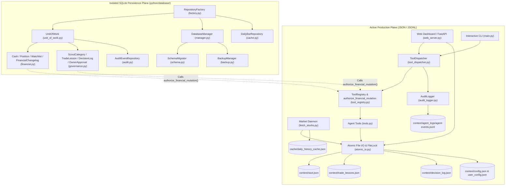
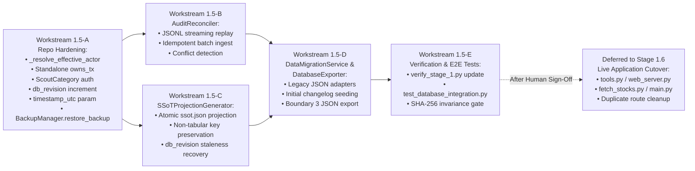

# Stage 1.5 — Architecture Assessment & Implementation Readiness

**Repository:** `nordicirish/gemini_cli_subagent_system`  
**Branch:** `main`  
**Preceding Stage:** Stage 1.4.1.3.2 — APPROVED AND CLOSED  
**Verified Preceding Implementation Commit:** `b74dfeac54253b5fcd3a9568b74d76e4fade9cfd`  
**Latest Documentation Commit (HEAD):** `0d22e59df2d695caca7fa293647fcb5304c0dc25`  
**Assessment Type:** Read-Only Architecture & Implementation Readiness Assessment  
**Date:** 2026-11-09  

---

## 1. Executive Summary and Overall Verdict

### 1.1 Assessment Summary

An independent, read-only architectural assessment of `nordicirish/gemini_cli_subagent_system` was conducted at commit `0d22e59df2d695caca7fa293647fcb5304c0dc25` (`main`) following the closure of Stage 1.4.1.3.2. The assessment inspected all 12 modules in the isolated SQLite persistence package (`python/database/`), all 9 runtime application and governance modules in `python/`, all 8 automated test suites in `tests/` (comprising 299 unit tests), the Stage 1 verification harness (`scripts/verify_stage_1.py`), all engineering governance protocols (`.agents/`), all prior Stage 1.2 through Stage 1.4.1.3.2 engineering reports, and the live JSON/JSONL persistence files under `context/`.

The core SQLite infrastructure (`DatabaseManager`, `SchemaMigrator`, `BackupManager`) and the financial repository triad (`CashRepository`, `PositionRepository`, `WatchlistRepository`, guarded by `FinancialChangelogRepository` and `_FinancialMutationCapability`) are well-structured, enforce exact `Decimal` representation (`TEXT` columns with lexical SQL `CHECK` verification), and remain 100% isolated from live production workflows.

However, direct source code inspection identified **eight concrete architectural findings (four High severity, three Medium severity, and one Low severity)** that must be addressed before the SQLite repository layer can be safely wired into live application entry points (`python/tools.py`, `python/web_server.py`, `python/fetch_stocks.py`, `python/main.py`):

1. **F-15-01 (High):** Write methods in `python/database/repositories/governance.py` (`TradeLessonRepository`, `DecisionLogRepository`, `ScoutCategoryRepository`, `OwnerApprovalRepository`) and `python/database/repositories/cache.py` (`DailyBarRepository.delete_bars`) lack standalone transaction wrapping (`owns_tx` / `BEGIN IMMEDIATE`) under `autocommit=True` connections, and `TradeLessonRepository` / `DecisionLogRepository` compute `effective_role = caller_role or active_role` instead of enforcing anti-spoofing actor resolution (`_resolve_effective_actor`).
2. **F-15-02 (High):** `AuditEventRepository.append_event()` (`python/database/repositories/audit.py`) executes its idempotency `SELECT` and subsequent `INSERT` without acquiring a `BEGIN IMMEDIATE` write lock when called outside a `UnitOfWork`, creating a time-of-check to time-of-use (TOCTOU) race condition for concurrent event replay.
3. **F-15-03 (High):** The monotonic revision counter `database_metadata.db_revision` (`python/database/schema.py`) is initialized to `0` but is never incremented by any repository mutation or `UnitOfWork.commit()`, leaving the planned `SSoTProjectionGenerator` without a functioning staleness-detection counter.
4. **F-15-04 (High):** The live JSON state files (`context/trade_lessons.json`, `context/decision_log.json`, `context/ssot.json`) exhibit structural and schema mismatches relative to the SQLite table constraints (missing `rule_code`/`category` fields in `trade_lessons.json`, heterogeneous entry shapes in `decision_log.json`, non-tabular analytical context sections in `ssot.json`, and hardcoded `utc_now_iso()` timestamps across repository write methods that prevent historical timestamp preservation during initial migration).
5. **F-15-05 (Medium):** `ScoutCategoryRepository.upsert_category()` and `delete_category()` (`python/database/repositories/governance.py`) do not invoke `authorize_financial_mutation()` or block `ENGINEERING_ROLES`, diverging from the live `/api/scout_categories` endpoint in `python/web_server.py`.
6. **F-15-06 (Medium):** In-memory owner approvals (`GLOBAL_OWNER_APPROVAL` in `python/tool_registry.py`) and persistent SQLite owner approvals (`OwnerApprovalRepository` in `python/database/repositories/governance.py`) are not bridged, and `OwnerApprovalRepository.consume_approval()` returns `False` on re-consumption rather than raising a domain exception as previously described in the Stage 1.4.1 report.
7. **F-15-07 (Medium):** `python/fetch_stocks.py` executes unguarded file I/O at module import time (including a raw `open('context/ssot.json', 'w')` when `scout_categories` is non-empty), `python/fetch_stocks.py` and `python/web_server.py` register duplicate/overlapping FastAPI routes on the shared `app` instance (`/api/save_basket` vs. `/api/basket`, `/api/save_watch_list` vs. `/api/watchlist`), and `MarketDataCache.save_to_disk()` calls `os.makedirs("context", exist_ok=True)` before writing to `"cache/daily_history_cache.json"`.
8. **F-15-08 (Low):** `scripts/verify_stage_1.py` (`check_compilation`) omits all 12 `python/database/` modules and 3 test modules from its explicit `py_compile` list, and `requirements.txt` retains an unused `peewee==4.5.3` dependency.

### 1.2 Overall Verdict

**Verdict:** **READY WITH CONDITIONS**

Stage 1.5 implementation is ready to proceed **on condition** that Stage 1.5 is scoped as a **strictly isolated pre-cutover hardening, reconciliation, projection, and migration-service stage** (remediating `F-15-01` through `F-15-05` and `F-15-08`, and implementing `AuditReconciler`, `SSoTProjectionGenerator`, `DataMigrationService`, and `DatabaseExporter` within `python/database/`), while deferring live production cutover (rewiring `python/tools.py`, `python/web_server.py`, `python/fetch_stocks.py`, and initializing live `context/gem.db` / `cache/market_data.db`) to Stage 1.6 after all pre-cutover components and migration dry-runs are independently verified.

---

## 2. Verified Repository Baseline

### 2.1 Git State and Lineage Verification

All mandatory initial checks from Section 2 were executed via read-only Git and filesystem commands:

| Verification Check | Command Executed | Verified Result | Status |
|---|---|---|---|
| Active Branch | `git branch --show-current` | `main` | Verified |
| Current `HEAD` Commit | `git rev-parse HEAD` | `0d22e59df2d695caca7fa293647fcb5304c0dc25` | Verified |
| Working-Tree Status | `git status --short --branch` | `## main...origin/main` (0 modified or untracked files) | Verified |
| Stage 1.4.1.3.2 Implementation Ancestor | `git merge-base --is-ancestor b74dfeac54253b5fcd3a9568b74d76e4fade9cfd HEAD` | Exit code `0` (direct parent `HEAD~1`) | Verified |
| Stage 1.4.1.3.2 Documentation Commit | `git show --stat 0d22e59df2d695caca7fa293647fcb5304c0dc25` | Updated [STAGE_1_4_1_3_2_PRODUCTION_TEST_SEAM_REMOVAL_REPORT.md](file:///c:/github/gemini_cli_subagent_system/docs/engineering/STAGE_1_4_1_3_2_PRODUCTION_TEST_SEAM_REMOVAL_REPORT.md) (`+4/-2` lines) | Verified |
| Core SQLite DB Absence | `Test-Path context/gem.db` | `False` (file does not exist) | Verified |
| Cache SQLite DB Absence | `Test-Path cache/market_data.db` | `False` (file does not exist) | Verified |

### 2.2 Authoritative State & Rules File SHA-256 Baseline

Cryptographic SHA-256 digests of all authoritative state, configuration, and trading rule files were recorded before and after read-only test execution to confirm zero state mutation:

| File Path | Pre-Assessment SHA-256 | Post-Test SHA-256 | Invariance |
|---|---|---|---|
| [context/ssot.json](file:///c:/github/gemini_cli_subagent_system/context/ssot.json) | `0A2BA4D8C125D213C5772B36164637DF74094CA95E28E2CA0AFC2DA5E55414DA` | `0A2BA4D8C125D213C5772B36164637DF74094CA95E28E2CA0AFC2DA5E55414DA` | 100% Identical |
| [context/trade_lessons.json](file:///c:/github/gemini_cli_subagent_system/context/trade_lessons.json) | `0C4AC816009CB348F4BC923D94124F41F5C6D1EC8722A487BBA9115F66029463` | `0C4AC816009CB348F4BC923D94124F41F5C6D1EC8722A487BBA9115F66029463` | 100% Identical |
| [context/decision_log.json](file:///c:/github/gemini_cli_subagent_system/context/decision_log.json) | `757E0B4855458CE7075EC16697798B3047CCC72A6214CDED6D7BBB1346700AF2` | `757E0B4855458CE7075EC16697798B3047CCC72A6214CDED6D7BBB1346700AF2` | 100% Identical |
| [context/config.json](file:///c:/github/gemini_cli_subagent_system/context/config.json) | `30EA2B67DD0ECAC4B16E3E726C9644948119729023D382C385301F9DB72099D5` | `30EA2B67DD0ECAC4B16E3E726C9644948119729023D382C385301F9DB72099D5` | 100% Identical |
| [context/user_config.json](file:///c:/github/gemini_cli_subagent_system/context/user_config.json) | `88E00F3EF6609EBA02066CDFB3750152BFA2B97667ACEED5CFBA30B5DB607183` | `88E00F3EF6609EBA02066CDFB3750152BFA2B97667ACEED5CFBA30B5DB607183` | 100% Identical |
| [context/agent_logs/agent-events.jsonl](file:///c:/github/gemini_cli_subagent_system/context/agent_logs/agent-events.jsonl) | `58A830FE4A59A02BB16D33DF10C1A09B3E76A2B6250377E26EE37A8D73D8BC3D` | `58A830FE4A59A02BB16D33DF10C1A09B3E76A2B6250377E26EE37A8D73D8BC3D` | 100% Identical |
| [config.json](file:///c:/github/gemini_cli_subagent_system/config.json) | `10C005EFA15940D9C503AAE62BBCB9A195DDBE249387C8335A4CB0F836064EE3` | `10C005EFA15940D9C503AAE62BBCB9A195DDBE249387C8335A4CB0F836064EE3` | 100% Identical |
| [gem_trading_rules/rules.md](file:///c:/github/gemini_cli_subagent_system/gem_trading_rules/rules.md) | `04EA36C0762DE30C841BB25AC35BDFFEB6845CCCFBA19A9B94D343743C075056` | `04EA36C0762DE30C841BB25AC35BDFFEB6845CCCFBA19A9B94D343743C075056` | 100% Identical |

### 2.3 Evidence Inventory (Section 8 Verification Distinction)

In accordance with Section 8 of the Stage 1.5 assessment directive, the evidence basis is explicitly categorized below:

1. **Governance & Prior Engineering Reports Inspected:**
   - [INSTRUCTIONS.md](file:///c:/github/gemini_cli_subagent_system/INSTRUCTIONS.md) and [.agents/AGENTS.md](file:///c:/github/gemini_cli_subagent_system/.agents/AGENTS.md)
   - Protocols [01-agent-orchestration.md](file:///c:/github/gemini_cli_subagent_system/.agents/protocols/01-agent-orchestration.md), [02-development-standards.md](file:///c:/github/gemini_cli_subagent_system/.agents/protocols/02-development-standards.md), [03-security-policy.md](file:///c:/github/gemini_cli_subagent_system/.agents/protocols/03-security-policy.md), [04-review-gates.md](file:///c:/github/gemini_cli_subagent_system/.agents/protocols/04-review-gates.md), [05-testing-policy.md](file:///c:/github/gemini_cli_subagent_system/.agents/protocols/05-testing-policy.md), and [06-financial-boundaries.md](file:///c:/github/gemini_cli_subagent_system/.agents/protocols/06-financial-boundaries.md)
   - Role definition [architecture-agent.md](file:///c:/github/gemini_cli_subagent_system/.agents/agents/architecture-agent.md)
   - Stage 1.2 & 1.2.1 reports: [STAGE_1_2_SQLITE_FEASIBILITY_ASSESSMENT.md](file:///c:/github/gemini_cli_subagent_system/docs/engineering/STAGE_1_2_SQLITE_FEASIBILITY_ASSESSMENT.md), [STAGE_1_2_1_ARCHITECTURE_CORRECTIONS.md](file:///c:/github/gemini_cli_subagent_system/docs/engineering/STAGE_1_2_1_ARCHITECTURE_CORRECTIONS.md)
   - Stage 1.3 reports: [STAGE_1_3_SQLITE_CORE_INFRASTRUCTURE_REPORT.md](file:///c:/github/gemini_cli_subagent_system/docs/engineering/STAGE_1_3_SQLITE_CORE_INFRASTRUCTURE_REPORT.md), [STAGE_1_3_1_SQLITE_INTEGRITY_CORRECTIONS_REPORT.md](file:///c:/github/gemini_cli_subagent_system/docs/engineering/STAGE_1_3_1_SQLITE_INTEGRITY_CORRECTIONS_REPORT.md), [STAGE_1_3_1_2_DECIMAL_AND_SCHEMA_VERIFICATION_REPORT.md](file:///c:/github/gemini_cli_subagent_system/docs/engineering/STAGE_1_3_1_2_DECIMAL_AND_SCHEMA_VERIFICATION_REPORT.md), [STAGE_1_3_1_3_SCHEMA_INTEGRITY_VERIFICATION_REPORT.md](file:///c:/github/gemini_cli_subagent_system/docs/engineering/STAGE_1_3_1_3_SCHEMA_INTEGRITY_VERIFICATION_REPORT.md), [STAGE_1_3_1_4_CHECK_CONSTRAINT_VERIFICATION_REPORT.md](file:///c:/github/gemini_cli_subagent_system/docs/engineering/STAGE_1_3_1_4_CHECK_CONSTRAINT_VERIFICATION_REPORT.md), [STAGE_1_3_1_5_SQL_LEXICAL_INTEGRITY_REPORT.md](file:///c:/github/gemini_cli_subagent_system/docs/engineering/STAGE_1_3_1_5_SQL_LEXICAL_INTEGRITY_REPORT.md), [STAGE_1_3_1_5_1_TRAILING_DDL_VALIDATION_REPORT.md](file:///c:/github/gemini_cli_subagent_system/docs/engineering/STAGE_1_3_1_5_1_TRAILING_DDL_VALIDATION_REPORT.md)
   - Stage 1.4 reports: [STAGE_1_4_REPOSITORY_LAYER_IMPLEMENTATION_REPORT.md](file:///c:/github/gemini_cli_subagent_system/docs/engineering/STAGE_1_4_REPOSITORY_LAYER_IMPLEMENTATION_REPORT.md), [STAGE_1_4_1_REPOSITORY_INTEGRITY_CORRECTIONS_REPORT.md](file:///c:/github/gemini_cli_subagent_system/docs/engineering/STAGE_1_4_1_REPOSITORY_INTEGRITY_CORRECTIONS_REPORT.md), [STAGE_1_4_1_1_FINANCIAL_CHANGELOG_ACTOR_AND_BATCH_ATOMICITY_REPORT.md](file:///c:/github/gemini_cli_subagent_system/docs/engineering/STAGE_1_4_1_1_FINANCIAL_CHANGELOG_ACTOR_AND_BATCH_ATOMICITY_REPORT.md), [STAGE_1_4_1_2_CAPABILITY_BOUNDARY_AND_SAVEPOINT_FAILURE_REPORT.md](file:///c:/github/gemini_cli_subagent_system/docs/engineering/STAGE_1_4_1_2_CAPABILITY_BOUNDARY_AND_SAVEPOINT_FAILURE_REPORT.md), [STAGE_1_4_1_3_CAPABILITY_MINTING_CLOSURE_REPORT.md](file:///c:/github/gemini_cli_subagent_system/docs/engineering/STAGE_1_4_1_3_CAPABILITY_MINTING_CLOSURE_REPORT.md), [STAGE_1_4_1_3_1_CAPABILITY_CREDENTIAL_AND_EXACT_STATE_REPORT.md](file:///c:/github/gemini_cli_subagent_system/docs/engineering/STAGE_1_4_1_3_1_CAPABILITY_CREDENTIAL_AND_EXACT_STATE_REPORT.md), [STAGE_1_4_1_3_2_PRODUCTION_TEST_SEAM_REMOVAL_REPORT.md](file:///c:/github/gemini_cli_subagent_system/docs/engineering/STAGE_1_4_1_3_2_PRODUCTION_TEST_SEAM_REMOVAL_REPORT.md)

2. **Source Code Inspected in Full:**
   - SQLite package (`python/database/`): [__init__.py](file:///c:/github/gemini_cli_subagent_system/python/database/__init__.py) (125 lines), [manager.py](file:///c:/github/gemini_cli_subagent_system/python/database/manager.py) (358 lines), [schema.py](file:///c:/github/gemini_cli_subagent_system/python/database/schema.py) (1,662 lines), [backup.py](file:///c:/github/gemini_cli_subagent_system/python/database/backup.py) (229 lines), [repositories/__init__.py](file:///c:/github/gemini_cli_subagent_system/python/database/repositories/__init__.py) (114 lines), [repositories/base.py](file:///c:/github/gemini_cli_subagent_system/python/database/repositories/base.py) (377 lines), [repositories/unit_of_work.py](file:///c:/github/gemini_cli_subagent_system/python/database/repositories/unit_of_work.py) (276 lines), [repositories/factory.py](file:///c:/github/gemini_cli_subagent_system/python/database/repositories/factory.py) (141 lines), [repositories/financial.py](file:///c:/github/gemini_cli_subagent_system/python/database/repositories/financial.py) (962 lines), [repositories/governance.py](file:///c:/github/gemini_cli_subagent_system/python/database/repositories/governance.py) (684 lines), [repositories/audit.py](file:///c:/github/gemini_cli_subagent_system/python/database/repositories/audit.py) (619 lines), [repositories/cache.py](file:///c:/github/gemini_cli_subagent_system/python/database/repositories/cache.py) (424 lines).
   - Application & runtime governance (`python/`): [tool_registry.py](file:///c:/github/gemini_cli_subagent_system/python/tool_registry.py) (599 lines), [tool_dispatcher.py](file:///c:/github/gemini_cli_subagent_system/python/tool_dispatcher.py) (308 lines), [tools.py](file:///c:/github/gemini_cli_subagent_system/python/tools.py) (554 lines), [audit_logger.py](file:///c:/github/gemini_cli_subagent_system/python/audit_logger.py) (99 lines), [atomic_io.py](file:///c:/github/gemini_cli_subagent_system/python/atomic_io.py) (316 lines), [main.py](file:///c:/github/gemini_cli_subagent_system/python/main.py) (262 lines), [agent_framework.py](file:///c:/github/gemini_cli_subagent_system/python/agent_framework.py) (737 lines), [web_server.py](file:///c:/github/gemini_cli_subagent_system/python/web_server.py) (1,426 lines), [fetch_stocks.py](file:///c:/github/gemini_cli_subagent_system/python/fetch_stocks.py) (3,834 lines).
   - Data & configuration files: [context/ssot.json](file:///c:/github/gemini_cli_subagent_system/context/ssot.json), [context/trade_lessons.json](file:///c:/github/gemini_cli_subagent_system/context/trade_lessons.json), [context/decision_log.json](file:///c:/github/gemini_cli_subagent_system/context/decision_log.json), [context/config.json](file:///c:/github/gemini_cli_subagent_system/context/config.json), [context/user_config.json](file:///c:/github/gemini_cli_subagent_system/context/user_config.json), [context/agent_logs/agent-events.jsonl](file:///c:/github/gemini_cli_subagent_system/context/agent_logs/agent-events.jsonl), [requirements.txt](file:///c:/github/gemini_cli_subagent_system/requirements.txt), and [scripts/verify_stage_1.py](file:///c:/github/gemini_cli_subagent_system/scripts/verify_stage_1.py).

3. **Test Suites Inspected AND Independently Executed:**
   - All 8 unit test modules in `tests/` were both inspected in source and independently executed in no-bytecode mode (`.\.venv\Scripts\python.exe -B -m unittest discover -s tests -p "test_*.py" -v`):
     - [tests/test_atomic_io.py](file:///c:/github/gemini_cli_subagent_system/tests/test_atomic_io.py) (329 lines)
     - [tests/test_audit_logger.py](file:///c:/github/gemini_cli_subagent_system/tests/test_audit_logger.py) (131 lines)
     - [tests/test_database_core.py](file:///c:/github/gemini_cli_subagent_system/tests/test_database_core.py) (2,097 lines)
     - [tests/test_database_repositories.py](file:///c:/github/gemini_cli_subagent_system/tests/test_database_repositories.py) (3,516 lines)
     - [tests/test_investment_regression.py](file:///c:/github/gemini_cli_subagent_system/tests/test_investment_regression.py) (107 lines)
     - [tests/test_permissions.py](file:///c:/github/gemini_cli_subagent_system/tests/test_permissions.py) (310 lines)
     - [tests/test_tool_dispatch.py](file:///c:/github/gemini_cli_subagent_system/tests/test_tool_dispatch.py) (285 lines)
     - [tests/test_watchlist_endpoints.py](file:///c:/github/gemini_cli_subagent_system/tests/test_watchlist_endpoints.py) (236 lines)
   - **Independent Execution Results:**
     - `.\.venv\Scripts\python.exe -m pip check`: `No broken requirements found` (Exit code `0`).
     - `py_compile` across all 29 Python modules in `python/` and `tests/` (compiled into a temporary directory with `-B`): `Compiled 29 files cleanly` (Exit code `0`).
     - `unittest discover`: **299 tests executed in 44.686s — 299 passed (`OK`), 0 failures, 0 errors.**

4. **Findings Remaining Unverified at Runtime:**
   - Live browser/SSE interaction with `python/web_server.py` and live Yahoo Finance polling loops in `python/fetch_stocks.py:run_daemon()` were not executed as live network daemons during this read-only assessment to avoid mutating `cache/daily_history_cache.json` or generating live LLM handshakes. Their behavior was assessed statically from source code.

---

## 3. Current Architecture Overview

The repository currently operates as a **strictly bifurcated dual-plane architecture** where the production runtime and the SQLite persistence layer have zero runtime coupling:

### 3.1 Active Production Plane (`python/*.py`)

1. **Orchestration & Subagent Execution ([python/agent_framework.py](file:///c:/github/gemini_cli_subagent_system/python/agent_framework.py), [python/main.py](file:///c:/github/gemini_cli_subagent_system/python/main.py), [python/web_server.py](file:///c:/github/gemini_cli_subagent_system/python/web_server.py)):**
   - `AgentFramework` runs local Antigravity CLI subprocesses via `AntigravityAgentRunner.run_prompt()` with `--sandbox` and `--disable-slash-commands`.
   - `AgentFramework._get_sys_instruction()` ([agent_framework.py](file:///c:/github/gemini_cli_subagent_system/python/agent_framework.py#L351-L372)) reads `gem_trading_rules/rules.md` and `context/trade_lessons.json` directly from disk when constructing the Orchestrator system prompt.
   - `web_server.chat_endpoint()` ([web_server.py](file:///c:/github/gemini_cli_subagent_system/python/web_server.py#L525-L848)) builds an auto-injected `DATA_PACKET` from `fetch_stocks.GLOBAL_STATE`, `context/trade_lessons.json`, and `context/decision_log.json`, dispatches turns via `GLOBAL_TOOL_DISPATCHER.execute_multi_turn_session()`, and extracts `EXECUTION_PAYLOAD` JSON blocks to call `tools.update_ssot()` or `tools.intercept_and_log_decision()`.
2. **Permission Gate & Tool Dispatch ([python/tool_registry.py](file:///c:/github/gemini_cli_subagent_system/python/tool_registry.py), [python/tool_dispatcher.py](file:///c:/github/gemini_cli_subagent_system/python/tool_dispatcher.py)):**
   - `ToolDispatcher` binds the active agent role via `execution_role_context(agent_role)` (`contextvars.ContextVar`), validates tool permissions through `ToolRegistry.validate_call()`, logs `ATTEMPTED` / `SUCCESS` / `DENIED` / `FAILED` events to `AuditLogger` (`context/agent_logs/agent-events.jsonl`), and enforces cycle detection and turn bounds (`MAX_TOOL_TURNS = 8`, `MAX_SUBAGENT_TOOL_TURNS = 3`).
   - Direct Python mutations to financial state call `authorize_financial_mutation()` ([tool_registry.py](file:///c:/github/gemini_cli_subagent_system/python/tool_registry.py#L318-L361)), which blocks `ENGINEERING_ROLES`, prevents role spoofing when an agent context is active, and checks `GLOBAL_OWNER_APPROVAL` when `requires_owner_approval=True`.
3. **JSON/JSONL File Persistence ([python/atomic_io.py](file:///c:/github/gemini_cli_subagent_system/python/atomic_io.py), [python/tools.py](file:///c:/github/gemini_cli_subagent_system/python/tools.py), [python/fetch_stocks.py](file:///c:/github/gemini_cli_subagent_system/python/fetch_stocks.py)):**
   - `atomic_write_json()`, `atomic_read_json()`, and `atomic_update_json()` provide reentrant thread/process locking via `.lock` sidecar files (`O_CREAT | O_EXCL`) and temp-file + `os.replace()` atomic swaps.
   - All live reads and writes (`tools.read_ssot`, `tools.update_ssot`, `tools.read_trade_lessons`, `tools.update_trade_lessons`, `tools.read_decision_log`, `tools.intercept_and_log_decision`, `fetch_stocks.handle_paste`, `web_server.save_basket`, `web_server.save_watch_list`, `web_server.save_scout_categories`, `web_server.save_decision_log`) operate exclusively on `context/ssot.json`, `context/trade_lessons.json`, `context/decision_log.json`, and `context/config.json`.

### 3.2 Isolated SQLite Persistence Plane (`python/database/`)

1. **Core Infrastructure ([manager.py](file:///c:/github/gemini_cli_subagent_system/python/database/manager.py), [schema.py](file:///c:/github/gemini_cli_subagent_system/python/database/schema.py), [backup.py](file:///c:/github/gemini_cli_subagent_system/python/database/backup.py)):**
   - `DatabaseManager` manages explicit SQLite connections (`autocommit=True` on Python 3.13) under two immutable profiles: `PRIMARY_FINANCIAL_PROFILE` (`journal_mode=WAL`, `synchronous=FULL`, `foreign_keys=ON`, `busy_timeout=5000`, `trusted_schema=OFF`) and `MARKET_DATA_CACHE_PROFILE` (`journal_mode=WAL`, `synchronous=NORMAL`, `foreign_keys=ON`, `busy_timeout=5000`, `trusted_schema=OFF`).
   - `SchemaMigrator` deploys and verifies `CURRENT_SCHEMA_VERSION = 1` across 10 core tables (`database_metadata`, `portfolio_cash`, `portfolio_positions`, `watchlist`, `scout_categories`, `trade_lessons`, `decision_log`, `financial_changelog`, `owner_approvals`, `audit_events`) and 2 cache tables (`cache_metadata`, `daily_bars`).
   - `BackupManager` performs online backups via `sqlite3.Connection.backup()`, verifies `PRAGMA integrity_check` on a temporary `.tmp` file, and places the verified snapshot atomically.
2. **Repository & Unit of Work Layer ([repositories/](file:///c:/github/gemini_cli_subagent_system/python/database/repositories/)):**
   - Implements 10 concrete repositories, `UnitOfWork` (`BEGIN IMMEDIATE` transaction lifecycle), and `RepositoryFactory`.
   - Zero production modules outside `python/database/` import `python.database`.

---

## 4. Completed Versus Incomplete Components

| Component / Subsystem | Target Location | Current Status | Assessment Notes |
|---|---|---|---|
| `DatabaseManager` & PRAGMA Verification | [python/database/manager.py](file:///c:/github/gemini_cli_subagent_system/python/database/manager.py) | **COMPLETE (ISOLATED)** | Enforces `PRIMARY_FINANCIAL_PROFILE` and `MARKET_DATA_CACHE_PROFILE`, `BEGIN IMMEDIATE` transactions, nested-tx rejection, `checkpoint()`, and `verify_integrity()`. |
| `SchemaMigrator` & Lexical DDL Verifier | [python/database/schema.py](file:///c:/github/gemini_cli_subagent_system/python/database/schema.py) | **COMPLETE (ISOLATED)** | Version 1 DDL for 10 core + 2 cache tables; strict lexical `CHECK` extractor immune to comment/quote spoofing and `OR 1=1` bypasses. |
| `BackupManager` (Online Backup API) | [python/database/backup.py](file:///c:/github/gemini_cli_subagent_system/python/database/backup.py) | **COMPLETE (ISOLATED)** | Online backup to `.tmp`, `PRAGMA integrity_check`, race-safe placement (`os.rename` / `os.replace`). Restore orchestration not yet wrapped in a higher-level CLI/service helper. |
| `CashRepository`, `PositionRepository`, `WatchlistRepository` | [python/database/repositories/financial.py](file:///c:/github/gemini_cli_subagent_system/python/database/repositories/financial.py) | **COMPLETE (ISOLATED)** | Enforces `authorize_financial_mutation`, `_resolve_effective_actor`, `owns_tx` (`BEGIN IMMEDIATE`), `SAVEPOINT` atomicity, and capability-bound changelog capture. Lacks `db_revision` increment and optional migration timestamp parameter. |
| `FinancialChangelogRepository` & Capability Minting | [python/database/repositories/financial.py](file:///c:/github/gemini_cli_subagent_system/python/database/repositories/financial.py) | **COMPLETE (ISOLATED)** | Closed minting boundary via `_acquire_mutation_credential` (code-object + `isinstance` verification) and exact post-mutation DB state cross-verification. |
| `TradeLessonRepository`, `DecisionLogRepository`, `ScoutCategoryRepository`, `OwnerApprovalRepository` | [python/database/repositories/governance.py](file:///c:/github/gemini_cli_subagent_system/python/database/repositories/governance.py) | **PARTIALLY IMPLEMENTED (ISOLATED)** | CRUD and append-only triggers work inside `UnitOfWork`, but standalone calls lack `owns_tx` (`BEGIN IMMEDIATE`), `TradeLesson`/`DecisionLog` lack `_resolve_effective_actor` anti-spoofing, and `ScoutCategory` lacks `authorize_financial_mutation` (`F-15-01`, `F-15-05`). |
| `AuditEventRepository` | [python/database/repositories/audit.py](file:///c:/github/gemini_cli_subagent_system/python/database/repositories/audit.py) | **PARTIALLY IMPLEMENTED (ISOLATED)** | Validates 32-hex lowercase UUIDs and idempotent conflict checks inside `UnitOfWork`, but standalone `append_event()` lacks `BEGIN IMMEDIATE` transaction wrapping (`F-15-02`). |
| `DailyBarRepository` | [python/database/repositories/cache.py](file:///c:/github/gemini_cli_subagent_system/python/database/repositories/cache.py) | **PARTIALLY IMPLEMENTED (ISOLATED)** | `upsert_bar` and `upsert_bars_batch` enforce `SAVEPOINT` atomicity and strict `Decimal` OHLC validation; `delete_bars` lacks standalone `owns_tx` transaction wrapping (`F-15-01`). |
| `UnitOfWork` & `RepositoryFactory` | [unit_of_work.py](file:///c:/github/gemini_cli_subagent_system/python/database/repositories/unit_of_work.py), [factory.py](file:///c:/github/gemini_cli_subagent_system/python/database/repositories/factory.py) | **PARTIALLY IMPLEMENTED (ISOLATED)** | Lifecycle (`_ensure_active`), `BEGIN IMMEDIATE`, and rollback on error are complete, but `UnitOfWork.commit()` never increments `database_metadata.db_revision` (`F-15-03`). |
| `SSoTProjectionGenerator` (`ssot.json` Projection & Staleness Recovery) | Planned in Stage 1.2.1 §6.4 | **NOT YET IMPLEMENTED** | Required to project authoritative SQLite state to `context/ssot.json` with `_projection_metadata` and recover stale/corrupt projections while preserving non-tabular SSoT context fields. |
| `AuditReconciler` (`agent-events.jsonl` -> `audit_events` Replay & Mirror Hook) | Planned in Stage 1.2.1 §7.2 | **NOT YET IMPLEMENTED** | Required to stream `context/agent_logs/agent-events.jsonl` into `audit_events` idempotently on startup and mirror live `AuditLogger.log_event()` writes. |
| `DataMigrationService` & `DatabaseExporter` (JSON <-> SQLite Migration & Rollback Export) | Planned in Stage 1.2.1 §9.1 | **NOT YET IMPLEMENTED** | Required to transform legacy shapes in `trade_lessons.json`, `decision_log.json`, `ssot.json`, and `daily_history_cache.json` into SQLite and export committed DB state back to JSON for Boundary 3 rollback. |
| Live Application Persistence Wiring (`tools.py`, `web_server.py`, `fetch_stocks.py`, `main.py`) | `python/*.py` | **NOT YET IMPLEMENTED** | All live tools, FastAPI endpoints, and daemon loops still read/write JSON files directly. |

---

## 5. Detailed Architecture Assessment & Critical Engineering Questions

This section evaluates the 12 architectural areas mandated in Section 3 and explicitly answers the 10 Critical Engineering Questions from Section 4 with concrete source file, method, and test references.

### Question 1: Is the SQLite repository layer ready for controlled integration with existing application components?

**Assessment:** **Not immediately for direct live cutover; ready for Stage 1.5 pre-cutover hardening and service construction.**

- **Supporting Evidence:**
  - The core financial repositories ([`CashRepository`](file:///c:/github/gemini_cli_subagent_system/python/database/repositories/financial.py#L463-L598), [`PositionRepository`](file:///c:/github/gemini_cli_subagent_system/python/database/repositories/financial.py#L601-L780), [`WatchlistRepository`](file:///c:/github/gemini_cli_subagent_system/python/database/repositories/financial.py#L783-L962)) and [`UnitOfWork`](file:///c:/github/gemini_cli_subagent_system/python/database/repositories/unit_of_work.py#L28-L276) are thoroughly hardened and tested by 299 unit tests.
  - However, four concrete gaps block immediate rewiring of `python/tools.py`, `python/web_server.py`, and `python/fetch_stocks.py`:
    1. Governance and audit repositories ([`governance.py`](file:///c:/github/gemini_cli_subagent_system/python/database/repositories/governance.py), [`audit.py`](file:///c:/github/gemini_cli_subagent_system/python/database/repositories/audit.py)) do not open `BEGIN IMMEDIATE` transactions when called outside a `UnitOfWork` (`F-15-01`, `F-15-02`).
    2. `database_metadata.db_revision` is never incremented (`F-15-03`).
    3. Legacy JSON data structures in [context/trade_lessons.json](file:///c:/github/gemini_cli_subagent_system/context/trade_lessons.json), [context/decision_log.json](file:///c:/github/gemini_cli_subagent_system/context/decision_log.json), and [context/ssot.json](file:///c:/github/gemini_cli_subagent_system/context/ssot.json) cannot be ingested by the repositories without deterministic schema-mapping adapters (`F-15-04`).
    4. The supporting integration services designed in Stage 1.2.1 (`SSoTProjectionGenerator`, `AuditReconciler`, `DataMigrationService`, `DatabaseExporter`) have not yet been authored.

### Question 2: Does the database remain isolated from legacy JSON-backed production workflows?

**Assessment:** **Yes — 100% isolated.**

- **Supporting Evidence:**
  - Inspected all 9 runtime modules in `python/` ([main.py](file:///c:/github/gemini_cli_subagent_system/python/main.py), [web_server.py](file:///c:/github/gemini_cli_subagent_system/python/web_server.py), [fetch_stocks.py](file:///c:/github/gemini_cli_subagent_system/python/fetch_stocks.py), [agent_framework.py](file:///c:/github/gemini_cli_subagent_system/python/agent_framework.py), [tools.py](file:///c:/github/gemini_cli_subagent_system/python/tools.py), [tool_registry.py](file:///c:/github/gemini_cli_subagent_system/python/tool_registry.py), [tool_dispatcher.py](file:///c:/github/gemini_cli_subagent_system/python/tool_dispatcher.py), [audit_logger.py](file:///c:/github/gemini_cli_subagent_system/python/audit_logger.py), [atomic_io.py](file:///c:/github/gemini_cli_subagent_system/python/atomic_io.py)): zero imports of `python.database` or `database` exist in any production module.
  - Verified on disk that `context/gem.db` and `cache/market_data.db` do not exist.
  - Verified in [`TestImportAndLifecycleSafety`](file:///c:/github/gemini_cli_subagent_system/tests/test_database_repositories.py#L1211-L1286) and [`TestPersistenceIsolation`](file:///c:/github/gemini_cli_subagent_system/tests/test_database_core.py#L1189-L1250) that importing and exercising `python.database` produces zero side effects on authoritative state files.

### Question 3: Are financial mutations consistently governed by authorization, trusted actor attribution, transactions, and mandatory changelog capture?

**Assessment:** **Yes for `financial.py` (`CashRepository`, `PositionRepository`, `WatchlistRepository`); partially inconsistent in `governance.py` (`TradeLessonRepository`, `DecisionLogRepository`, `ScoutCategoryRepository`).**

- **Supporting Evidence:**
  - **In [python/database/repositories/financial.py](file:///c:/github/gemini_cli_subagent_system/python/database/repositories/financial.py):**
    - All six mutation methods (`CashRepository.set_cash_balance`, `CashRepository.delete_cash`, `PositionRepository.upsert_position`, `PositionRepository.delete_position`, `WatchlistRepository.upsert_watchlist_item`, `WatchlistRepository.remove_watchlist_item`) call [`_resolve_effective_actor(caller_role)`](file:///c:/github/gemini_cli_subagent_system/python/database/repositories/financial.py#L46-L70) first, rejecting any call where `caller_role is not None and caller_role != active_role` with `PermissionError`.
    - All six methods call [`authorize_financial_mutation()`](file:///c:/github/gemini_cli_subagent_system/python/tool_registry.py#L318-L361) with the exact `operation_name`, `target_resource`, and `payload`.
    - All six methods open `BEGIN IMMEDIATE;` when `not self._conn.in_transaction` (`owns_tx = True`) and wrap the before-state query, row mutation, capability minting (`_acquire_mutation_credential()`), and [`FinancialChangelogRepository.append_entry()`](file:///c:/github/gemini_cli_subagent_system/python/database/repositories/financial.py#L294-L423) inside a single `SAVEPOINT` (`sp_<op>_<uuid>`) so any failure rolls back both the mutation and the changelog entry.
  - **Gaps in [python/database/repositories/governance.py](file:///c:/github/gemini_cli_subagent_system/python/database/repositories/governance.py):**
    - [`TradeLessonRepository.upsert_lesson()`](file:///c:/github/gemini_cli_subagent_system/python/database/repositories/governance.py#L259-L267), [`TradeLessonRepository.delete_lesson()`](file:///c:/github/gemini_cli_subagent_system/python/database/repositories/governance.py#L305-L313), and [`DecisionLogRepository.append_decision()`](file:///c:/github/gemini_cli_subagent_system/python/database/repositories/governance.py#L356-L364) use `effective_role = caller_role or active_role` instead of `_resolve_effective_actor(caller_role)`. When `active_role == "System"` (the default when no `execution_role_context` is active), `authorize_financial_mutation()` trusts `caller_role` ([tool_registry.py](file:///c:/github/gemini_cli_subagent_system/python/tool_registry.py#L333)), allowing a caller in `"System"` context to spoof any authorized role string (`F-15-01`).
    - [`ScoutCategoryRepository.upsert_category()`](file:///c:/github/gemini_cli_subagent_system/python/database/repositories/governance.py#L116-L148) and [`delete_category()`](file:///c:/github/gemini_cli_subagent_system/python/database/repositories/governance.py#L150-L155) do not invoke `authorize_financial_mutation()` at all (`F-15-05`).

### Question 4: Is the audit trail sufficiently trustworthy for subsequent integration?

**Assessment:** **The schema, append-only SQLite triggers, secret redaction, and financial changelog verification are trustworthy, subject to fixing the standalone transaction lock in `AuditEventRepository.append_event()` (`F-15-02`).**

- **Supporting Evidence:**
  - **Append-Only Database Triggers:** [`CORE_SCHEMA_DDL`](file:///c:/github/gemini_cli_subagent_system/python/database/schema.py#L120-L240) installs `BEFORE UPDATE` and `BEFORE DELETE` triggers on `financial_changelog`, `audit_events`, and `decision_log` (and `BEFORE DELETE` + restricted `BEFORE UPDATE` on `owner_approvals`), raising `ABORT` on any mutation or deletion attempt.
  - **Capability-Guarded Financial Changelog:** Following Stage 1.4.1.3.1 and Stage 1.4.1.3.2, [`FinancialChangelogRepository.append_entry()`](file:///c:/github/gemini_cli_subagent_system/python/database/repositories/financial.py#L294-L423) requires an unconsumed `_FinancialMutationCapability` minted with a one-time `_MutationCredential` via [`_acquire_mutation_credential()`](file:///c:/github/gemini_cli_subagent_system/python/database/repositories/financial.py#L103-L133), which verifies both the caller's compiled `CodeType` object and `isinstance(self_obj, (CashRepository, PositionRepository, WatchlistRepository))` with zero test seams in production code. It then executes [`_verify_post_mutation_database_state()`](file:///c:/github/gemini_cli_subagent_system/python/database/repositories/financial.py#L148-L280) to confirm the live SQLite row matches `after_state` across every required and optional field (`wac_usd`, `notes`).
  - **JSONL Audit Logger Compatibility:** [`AuditLogger`](file:///c:/github/gemini_cli_subagent_system/python/audit_logger.py#L41-L95) generates 32-character lowercase hex UUIDs (`uuid.uuid4().hex`) and ISO-8601 UTC timestamps (`datetime.now(timezone.utc).isoformat()`) and applies [`redact_secrets()`](file:///c:/github/gemini_cli_subagent_system/python/audit_logger.py#L17-L29). Inspection of the 85 existing lines in [context/agent_logs/agent-events.jsonl](file:///c:/github/gemini_cli_subagent_system/context/agent_logs/agent-events.jsonl) confirmed every record satisfies the `audit_events` SQLite `CHECK` constraints (`length(event_id) = 32 AND event_id NOT GLOB '*[^0-9a-f]*'`).
  - **Remaining Gap:** [`AuditEventRepository.append_event()`](file:///c:/github/gemini_cli_subagent_system/python/database/repositories/audit.py#L78-L140) must wrap its `SELECT` + `INSERT` in `BEGIN IMMEDIATE` when called outside a `UnitOfWork` (`F-15-02`).

### Question 5: Do transaction boundaries and failure handling remain correct across nested operations?

**Assessment:** **Yes for `DatabaseManager.transaction()`, `UnitOfWork`, `financial.py`, and `cache.py` (`upsert_bar` / `upsert_bars_batch`); incomplete for standalone calls in `governance.py`, `audit.py`, and `cache.py:delete_bars`.**

- **Supporting Evidence:**
  - [`DatabaseManager.transaction()`](file:///c:/github/gemini_cli_subagent_system/python/database/manager.py#L220-L264) checks `if conn.in_transaction:` and raises `DatabaseTransactionError("Nested transactions are not supported...")` fail-closed before executing `BEGIN IMMEDIATE;`.
  - [`UnitOfWork.__enter__()`](file:///c:/github/gemini_cli_subagent_system/python/database/repositories/unit_of_work.py#L77-L102) similarly rejects connections already in a transaction and executes `BEGIN IMMEDIATE;`.
  - Inside an active transaction (whether initiated by `UnitOfWork` or standalone `owns_tx` in `financial.py`), individual repository operations use named `SAVEPOINT` blocks (`SAVEPOINT sp_...` / `RELEASE SAVEPOINT` / `ROLLBACK TO SAVEPOINT`). In [`financial.py`](file:///c:/github/gemini_cli_subagent_system/python/database/repositories/financial.py#L510-L534) and [`cache.py`](file:///c:/github/gemini_cli_subagent_system/python/database/repositories/cache.py#L251-L263), if `ROLLBACK TO SAVEPOINT` or `RELEASE SAVEPOINT` itself fails during exception handling and `owns_tx` is `True`, the outer transaction is explicitly rolled back (`self._conn.execute("ROLLBACK;")`), preventing dangling open transactions.
  - **Gap (`F-15-01`, `F-15-02`):** In `governance.py`, `audit.py`, and `cache.py:delete_bars`, methods do not check `owns_tx = not self._conn.in_transaction` and do not issue `BEGIN IMMEDIATE;` when called standalone on an `autocommit=True` connection.

### Question 6: Can backup and recovery procedures reliably preserve authoritative state?

**Assessment:** **Online backup creation and verification (`BackupManager`) are reliable; automated restore orchestration and post-cutover JSON rollback export (`DatabaseExporter`) are not yet implemented.**

- **Supporting Evidence:**
  - [`BackupManager.create_backup()`](file:///c:/github/gemini_cli_subagent_system/python/database/backup.py#L81-L163) uses SQLite's native Online Backup API (`src_conn.backup(dst_conn)`), which safely copies database pages even if concurrent WAL readers/writers are active, runs `PRAGMA integrity_check;` on the temporary `.tmp` backup file, and places the file using race-safe `os.rename()` (when `overwrite=False`) or `os.replace()` (when `overwrite=True`), cleaning up `.tmp` artifacts in `finally`.
  - However, `BackupManager` does not yet provide a `restore_backup()` method (which must verify backup integrity prior to restoring, close active `DatabaseManager` connections, remove stale `-wal` and `-shm` sidecar files, and atomically replace the target `.db` file), nor does `DatabaseExporter` exist yet to satisfy Stage 1.2.1 Boundary 3 rollback (`gem.db` -> canonical JSON files).

### Question 7: Are database initialization, schema validation, and migration procedures safe?

**Assessment:** **Schema initialization and structural/lexical validation (`SchemaMigrator`) are safe and fail-closed; data migration from legacy JSON files (`DataMigrationService`) is not yet implemented.**

- **Supporting Evidence:**
  - [`SchemaMigrator.initialize_core_schema()`](file:///c:/github/gemini_cli_subagent_system/python/database/schema.py#L645-L699) and [`initialize_cache_schema()`](file:///c:/github/gemini_cli_subagent_system/python/database/schema.py#L701-L751) check whether the database is empty; if already initialized, they verify `schema_version == CURRENT_SCHEMA_VERSION` (raising `SchemaVersionMismatchError` on unknown/future versions) and run [`verify_core_schema_integrity()`](file:///c:/github/gemini_cli_subagent_system/python/database/schema.py#L842-L900) / [`verify_cache_schema_integrity()`](file:///c:/github/gemini_cli_subagent_system/python/database/schema.py#L902-L953).
  - Schema verification is strictly read-only (verified over `?mode=ro` URI connections in [`TestSchemaVerificationReadOnlyAndFailClosed`](file:///c:/github/gemini_cli_subagent_system/tests/test_database_core.py#L1734-L1809)) and validates exact table inventories (rejecting unexpected user tables while ignoring `sqlite_*` internal tables), exact column ordering, declared types, `NOT NULL` flags, `DEFAULT` values, primary keys, foreign keys, index uniqueness/partial flags, and lexical SQL `CHECK` constraint equivalence.

### Question 8: Do any concurrency, idempotency, or integrity gaps remain?

**Assessment:** **Yes — specifically `F-15-01` (standalone transaction wrapping & actor attribution in `governance.py`), `F-15-02` (standalone `append_event` TOCTOU in `audit.py`), `F-15-03` (`db_revision` never incremented), and `F-15-07` (module-import file writes and duplicate routes in `fetch_stocks.py` / `web_server.py`).**

- All four gaps are detailed with exact line numbers and remediation specifications in Section 6 below.

### Question 9: Do existing tests adequately cover the architectural boundaries?

**Assessment:** **Existing unit tests provide strong coverage of `DatabaseManager`, `SchemaMigrator`, `BackupManager`, and `financial.py` (299 passing tests), but lack test coverage for standalone `autocommit=True` concurrency on `governance.py`/`audit.py`, `db_revision` progression, and real-fixture JSON-to-SQLite migration.**

- **Supporting Evidence:**
  - [tests/test_database_core.py](file:///c:/github/gemini_cli_subagent_system/tests/test_database_core.py) (95 tests) and [tests/test_database_repositories.py](file:///c:/github/gemini_cli_subagent_system/tests/test_database_repositories.py) (154 tests) thoroughly test PRAGMAs, lexical `CHECK` tampering, capability credential boundaries, `SAVEPOINT` rollbacks, and `Decimal` scale validation.
  - Because existing tests for `TradeLessonRepository` and `DecisionLogRepository` either passed `caller_role="Terminal Orchestrator"` under default `"System"` context ([test_database_repositories.py](file:///c:/github/gemini_cli_subagent_system/tests/test_database_repositories.py#L282-L320)) or tested unauthorized roles under `execution_role_context("Security Agent")`, the actor-spoofing discrepancy between `financial.py` and `governance.py` (`F-15-01`) was not caught by `TestTrustedActorAttribution` (which only tested `CashRepository`, `PositionRepository`, `WatchlistRepository`, and `OwnerApprovalRepository`).

### Question 10: Is introducing further abstraction, infrastructure, or dependencies genuinely necessary?

**Assessment:** **Zero external library dependencies are needed (`peewee` should be removed). Only the four lightweight, standard-library internal modules already specified in Stage 1.2.1 (`AuditReconciler`, `SSoTProjectionGenerator`, `DataMigrationService`/`DatabaseExporter`, and `BackupManager.restore_backup`) are necessary.**

- **Supporting Evidence:**
  - Python 3.13's built-in `sqlite3`, `decimal`, `hashlib`, `json`, and `tempfile` modules satisfy every persistence, integrity, and online-backup requirement for this single-user, locally operated system.
  - Introducing connection pools, external ORMs (`SQLAlchemy`, `peewee`), migration frameworks (`Alembic`), or message queues would add unnecessary complexity and attack surface.

---

## 6. Prioritised Findings and Risk Matrix

The table below catalogues all concrete architectural gaps and defects identified during the Stage 1.5 inspection, ordered by severity and priority.

| Finding ID | Severity | Affected Component | Exact Source File & Method | Description of Problem / Architectural Gap | Evidence from Actual Implementation | Potential Consequences | Recommended Remediation | Required Before / During Stage 1.5? |
|---|---|---|---|---|---|---|---|---|
| **F-15-01** | **High** | Governance & Cache Repositories (`TradeLesson`, `DecisionLog`, `ScoutCategory`, `OwnerApproval`, `DailyBar`) | [governance.py](file:///c:/github/gemini_cli_subagent_system/python/database/repositories/governance.py): `TradeLessonRepository.upsert_lesson` (L222–288), `delete_lesson` (L290–320), `DecisionLogRepository.append_decision` (L336–387), `ScoutCategoryRepository.upsert_category` (L116–148), `delete_category` (L150–155), `OwnerApprovalRepository.append_approval` (L500–547), `consume_approval` (L626–643); [cache.py](file:///c:/github/gemini_cli_subagent_system/python/database/repositories/cache.py): `DailyBarRepository.delete_bars` (L398–424) | **1. Actor Attribution Anti-Spoofing Gap:** `upsert_lesson`, `delete_lesson`, and `append_decision` evaluate `effective_role = caller_role or active_role` instead of calling `_resolve_effective_actor(caller_role)`. When `active_role == "System"`, `authorize_financial_mutation` trusts `caller_role`, allowing a caller in default `"System"` context to spoof another role. **2. Missing Standalone Transaction Wrapping (`owns_tx`):** Unlike `financial.py`, none of the write methods in `governance.py` or `cache.py:delete_bars` check `owns_tx = not self._conn.in_transaction` to issue `BEGIN IMMEDIATE;` / `COMMIT;` / `ROLLBACK;`. | In `governance.py:270-274`, `upsert_lesson` runs `existing = self.get_lesson(norm_code)` followed by `INSERT INTO trade_lessons ...` as two separate statements on an `autocommit=True` connection without a write lock. In `governance.py:260`, `effective_role = caller_role or active_role` does not verify `caller_role == active_role`. | 1. Untrusted `caller_role` arguments can forge audit/attribution metadata when called from `"System"` context. 2. Standalone calls outside `UnitOfWork` suffer TOCTOU races between pre-read (`get_lesson`) and write (`INSERT`). | 1. Move `_resolve_effective_actor(caller_role)` to `repositories/base.py` and enforce it across all governed write methods in `financial.py` and `governance.py`. 2. Wrap all standalone repository write methods in `owns_tx = not self._conn.in_transaction` (`BEGIN IMMEDIATE` / `COMMIT` / `ROLLBACK`). | **Yes — Mandatory in Stage 1.5 Workstream A (before any migration or cutover).** |
| **F-15-02** | **High** | Audit Event Repository (`AuditEventRepository`) | [audit.py](file:///c:/github/gemini_cli_subagent_system/python/database/repositories/audit.py): `AuditEventRepository.append_event` (L38–140) | **Standalone Autocommit TOCTOU Race in Idempotent Event Replay:** When `append_event` is called outside a `UnitOfWork` (`self._conn.in_transaction == False`), it executes `SELECT ... WHERE event_id = ?` (L81) and `INSERT INTO audit_events ...` (L121) as separate autocommit statements without acquiring a `BEGIN IMMEDIATE` write lock. | `audit.py:80-135`: `cur = self._conn.cursor(); cur.execute("SELECT ... WHERE event_id = ?", (norm_event_id,))` is followed by `cur.execute("INSERT INTO audit_events ...")`. If `sqlite3.IntegrityError` occurs on `INSERT`, L137–140 immediately raises `IntegrityConflictError` without re-querying whether a concurrent writer inserted the identical payload. | Concurrent live event mirroring (`AuditLogger`) and startup/background `AuditReconciler` replaying the same `event_id` can hit a false-positive `IntegrityConflictError` instead of succeeding idempotently. | Wrap `AuditEventRepository.append_event` in `owns_tx = not self._conn.in_transaction` (`BEGIN IMMEDIATE` / `COMMIT` / `ROLLBACK`) so the `SELECT` and `INSERT` execute atomically under a write lock. | **Yes — Mandatory in Stage 1.5 Workstream A.** |
| **F-15-03** | **High** | Database Metadata Revision Counter (`db_revision`) | [schema.py](file:///c:/github/gemini_cli_subagent_system/python/database/schema.py) (L46), [unit_of_work.py](file:///c:/github/gemini_cli_subagent_system/python/database/repositories/unit_of_work.py): `UnitOfWork.commit` (L126–134), [financial.py](file:///c:/github/gemini_cli_subagent_system/python/database/repositories/financial.py), [governance.py](file:///c:/github/gemini_cli_subagent_system/python/database/repositories/governance.py) | **`database_metadata.db_revision` Is Never Incremented:** `database_metadata` defines `db_revision INTEGER NOT NULL DEFAULT 0` to track monotonic state revisions for `SSoTProjectionGenerator` staleness detection and Boundary 2 rollback checks, but no code anywhere in `python/database/` ever increments `db_revision`. | Searching `python/database/` for `db_revision` shows it is only referenced in `schema.py` DDL (`DEFAULT 0`) and `initialize_core_schema` (`INSERT ... VALUES (1, 1, 0, ?, ?)`). After any number of repository writes or `UnitOfWork.commit()` calls, `db_revision` remains `0`. | `SSoTProjectionGenerator` cannot detect stale `context/ssot.json` projections (`_projection_metadata.db_revision < database_metadata.db_revision`), and Boundary 2 pre-cutover verification (`db_revision == 0`) cannot distinguish a mutated database from an unmutated one. | Add a helper `_increment_db_revision(conn, timestamp_utc)` in `repositories/base.py` (`UPDATE database_metadata SET db_revision = db_revision + 1, last_updated_at_utc = ? WHERE id = 1`) and invoke it inside every core state write transaction (or once per committed `UnitOfWork` when mutations occurred, plus standalone repository write transactions) and expose `get_db_revision(conn)`. | **Yes — Mandatory in Stage 1.5 Workstream A.** |
| **F-15-04** | **High** | Legacy JSON State Schemas vs. SQLite Repository Models | [context/trade_lessons.json](file:///c:/github/gemini_cli_subagent_system/context/trade_lessons.json) (L1–102), [context/decision_log.json](file:///c:/github/gemini_cli_subagent_system/context/decision_log.json) (L1–191), [context/ssot.json](file:///c:/github/gemini_cli_subagent_system/context/ssot.json) (L1–15), [governance.py](file:///c:/github/gemini_cli_subagent_system/python/database/repositories/governance.py), [financial.py](file:///c:/github/gemini_cli_subagent_system/python/database/repositories/financial.py) | **Structural & Schema Mismatch Between Live JSON Files and SQLite Tables:** 1. `trade_lessons.json` has 24 items shaped `{"id": 1, "rule": "L-219: ..."}`; items 16 and 17 have no `L-xxx:` prefix; no item has `rule_code`, `category` (`MANDATE`/`EXECUTION`/`STRUCTURAL`/`RISK`/`HEURISTIC`), or timestamps. 2. `decision_log.json` mixes two incompatible shapes: `AI_COUNCIL_AUTO` summary objects (`date`, `ticker`, `lesson`, `outcome`) and `STAGE_0_BOOT_SYNC` objects containing nested `decisions` arrays. 3. `ssot.json` carries rich non-tabular keys (`state_context`, `forensic_intelligence`, `EXECUTION_PAYLOAD`, etc.) not stored in `portfolio_cash` / `portfolio_positions` / `watchlist` / `scout_categories`. 4. All repository write methods hardcode `utc_now_iso()` with no parameter to preserve historical timestamps during migration. | Direct comparison of `context/trade_lessons.json` (L64–72: `id: 16` `"SHORT_GAMMA_RTH_LIQUIDATION_EXPEDITER - ..."`) and `context/decision_log.json` (L3–9 vs. L10–189) against `TradeLessonRepository.upsert_lesson(rule_code, directive_text, category)` and `DecisionLogRepository.append_decision(session_id, action_proposed, decision_outcome, ...)`. | 1. Naive migration of `trade_lessons.json` or `decision_log.json` will fail with `ValidationError` or lose fields. 2. Overwriting `ssot.json` purely from the 4 SQLite tables without merging existing non-tabular SSoT keys will destroy `state_context` and `forensic_intelligence`. 3. Historical `decision_log` timestamps (`2026-09-22T15:01:03`) would be overwritten with current migration time. | 1. Add optional `timestamp_utc: Optional[str] = None` to repository write methods. 2. Build deterministic parsing/normalization adapters in `DataMigrationService` for `trade_lessons.json`, `decision_log.json`, `ssot.json`, and `daily_history_cache.json`. 3. Design `SSoTProjectionGenerator` to update only the authoritative financial/watchlist/scout keys inside `ssot.json` (plus `_projection_metadata`) via `atomic_update_json`, preserving non-tabular SSoT analytical sections intact. | **Yes — Mandatory in Stage 1.5 Workstreams A, C, and D.** |
| **F-15-05** | **Medium** | Scout Category Repository Authorization (`ScoutCategoryRepository`) | [governance.py](file:///c:/github/gemini_cli_subagent_system/python/database/repositories/governance.py): `ScoutCategoryRepository.upsert_category` (L116–148), `delete_category` (L150–155) | **Missing `authorize_financial_mutation()` in `ScoutCategoryRepository`:** Unlike `web_server.py:save_scout_categories` (L1343), which calls `authorize_financial_mutation("update_ssot", "context/ssot.json", payload=categories)`, `ScoutCategoryRepository.upsert_category` and `delete_category` perform zero role or permission checks. | `governance.py:116-155` contains no call to `authorize_financial_mutation` or `_resolve_effective_actor`. Any role (including `ENGINEERING_ROLES` such as `"Python Engineer"`) can mutate `scout_categories` in `context/gem.db`. | Engineering agents or unauthorized council subagents could modify active scout categories in SQLite, bypassing the financial boundary enforced on `ssot.json`. | Add `_resolve_effective_actor(caller_role)` and `authorize_financial_mutation(operation_name="update_ssot", target_resource=f"scout_categories/{norm_name}", ...)` to `ScoutCategoryRepository.upsert_category` and `delete_category`. | **Yes — Mandatory in Stage 1.5 Workstream A.** |
| **F-15-06** | **Medium** | Owner Approval Persistence & Consumption Semantics | [tool_registry.py](file:///c:/github/gemini_cli_subagent_system/python/tool_registry.py): `OwnerApprovalManager` (L182–312); [governance.py](file:///c:/github/gemini_cli_subagent_system/python/database/repositories/governance.py): `OwnerApprovalRepository.consume_approval` (L626–643) | **1. Disconnected In-Memory vs. SQLite Owner Approvals:** `GLOBAL_OWNER_APPROVAL` tracks approvals in an in-memory `set`, completely disconnected from `OwnerApprovalRepository` (`owner_approvals` table). **2. Report vs. Code Discrepancy:** Stage 1.4.1 report (§3.2) stated `consume_approval` raises `OwnerApprovalAlreadyConsumedError`, but `governance.py:643` actually returns `bool` (`cur.rowcount > 0`, which is tested by `test_database_repositories.py:380-381`). | `tool_registry.py:201` stores `self._pending_grants: Set[Tuple[str, str, str]] = set()`. `governance.py:626-643` updates `owner_approvals` in SQLite and returns `cur.rowcount > 0` (`False` on replay). | Approvals granted in memory are not persisted to `owner_approvals` in SQLite (and vice versa) unless bridged during cutover. Note: returning `False` on `consume_approval` is tested and clean, so the report discrepancy is informational, while bridging `OwnerApprovalManager` to `OwnerApprovalRepository` is a cutover task. | Document that `OwnerApprovalRepository.consume_approval` returns `bool` (`False` when already consumed) as the canonical contract, and provide an optional repository listener/backing hook in `OwnerApprovalManager` during Stage 1.6 live cutover. | **Document in Stage 1.5; bridge during Stage 1.6 live cutover.** |
| **F-15-07** | **Medium** | Legacy Runtime Entry Points & Market Cache (`fetch_stocks.py`, `web_server.py`) | [fetch_stocks.py](file:///c:/github/gemini_cli_subagent_system/python/fetch_stocks.py) (L265–270, L508–528, L564–569, L640–759, L1470–1493); [web_server.py](file:///c:/github/gemini_cli_subagent_system/python/web_server.py) (L467, L496, L909, L957, L997, L1010–1231) | **1. Import-Time Side Effects:** Importing `fetch_stocks` executes `initialize_context_files()`, `compile_master_document()`, and L508–528 (which overwrites `context/ssot.json` via raw `open(..., 'w')` without `atomic_update_json` or `authorize_financial_mutation` if `scout_categories` is non-empty). **2. Duplicate FastAPI Routes:** Both `fetch_stocks.py` (`/api/get_basket`, `/api/save_basket`, `/api/get_watch_list`, `/api/save_watch_list`, `/api/tickers`) and `web_server.py` (`/api/basket`, `/api/watchlist`, `/api/tickers`) register persistence endpoints on the same `app` object. **3. Latent Cache Directory Bug:** `MarketDataCache.save_to_disk()` (L1488) calls `os.makedirs("context", exist_ok=True)` before opening `"cache/daily_history_cache.json"`. | Direct inspection of `fetch_stocks.py:508-528`, `fetch_stocks.py:640-759`, `fetch_stocks.py:1488`, and `web_server.py:909-1231`. | When Stage 1.6 rewires live persistence to SQLite, leaving duplicate endpoints in `fetch_stocks.py` or leaving the L508–528 import-time `ssot.json` write in place would bypass SQLite and corrupt projection state. | Defer live file modifications of `fetch_stocks.py` and `web_server.py` to Stage 1.6 (Live Application Cutover), where all duplicate routes and import-time `ssot.json` mutations must be consolidated through the unified persistence service. | **Defer to Stage 1.6 (Live Cutover); mandatory gate before Stage 1.6 sign-off.** |
| **F-15-08** | **Low** | Verification Harness & Dependency Manifest (`verify_stage_1.py`, `requirements.txt`) | [scripts/verify_stage_1.py](file:///c:/github/gemini_cli_subagent_system/scripts/verify_stage_1.py): `check_compilation` (L90–127); [requirements.txt](file:///c:/github/gemini_cli_subagent_system/requirements.txt) (L26) | **1. Incomplete Compilation Gate:** `verify_stage_1.py:check_compilation` checks a hardcoded list of 16 Stage 1.1 files and omits all 12 `python/database/` modules and 3 newer `tests/` modules. **2. Unused Dependency:** `peewee==4.5.3` is listed in `requirements.txt` (L26) with zero usage across the repository. **3. Minor Doc Note:** Stage 1.4 report (§2) stated `busy_timeout (30,000ms)` whereas `PRIMARY_FINANCIAL_PROFILE` in `manager.py:97` configures `busy_timeout_ms=5000` (per Stage 1.2.1 §4.3). | Inspection of `scripts/verify_stage_1.py:92-109` (16 files vs. 29 actual Python files in `python/` and `tests/`) and `requirements.txt:26`. | Syntax errors in `python/database/` would not be flagged by Gate 2 (`check_compilation`) of `verify_stage_1.py` (though Gate 5 `check_unit_tests` imports them). | Update `scripts/verify_stage_1.py:check_compilation` in Stage 1.5 Workstream E to include all `python/database/` and `tests/` modules. (`peewee` removal from `requirements.txt` is optional/low-priority). | **Include `verify_stage_1.py` update in Stage 1.5 Workstream E.** |

---

## 7. Recommended Stage 1.5 Workstreams

To adhere to the governance principle of **small, independently verifiable stages** and preserve the **Stage 1.2.1 Boundary 2 pre-cutover rollback guarantee** (zero modifications to live production workflows or authoritative JSON files until all migration, projection, and reconciliation services are verified), Stage 1.5 should be scoped to **five cohesive, isolated workstreams inside `python/database/`, `tests/`, and `scripts/verify_stage_1.py`**, while deferring live production cutover (`python/tools.py`, `python/web_server.py`, `python/fetch_stocks.py`, `python/main.py`) to **Stage 1.6**.

### Workstream 1.5-A: Repository Transaction, Actor Attribution, Authorization & `db_revision` Hardening

- **Objective:** Close findings **F-15-01**, **F-15-02**, **F-15-03**, **F-15-05**, and the timestamp override requirement of **F-15-04** across `python/database/repositories/`.
- **Required Changes:**
  1. Move `_resolve_effective_actor(caller_role: Optional[str]) -> str` into [python/database/repositories/base.py](file:///c:/github/gemini_cli_subagent_system/python/database/repositories/base.py) and enforce it in `TradeLessonRepository.upsert_lesson`, `TradeLessonRepository.delete_lesson`, `DecisionLogRepository.append_decision`, `ScoutCategoryRepository.upsert_category`, and `ScoutCategoryRepository.delete_category`.
  2. Enforce `authorize_financial_mutation(operation_name="update_ssot", target_resource=..., payload=..., caller_role=effective_role, requires_owner_approval=requires_owner_approval)` in `ScoutCategoryRepository.upsert_category` and `ScoutCategoryRepository.delete_category`.
  3. Add standalone `owns_tx = not self._conn.in_transaction` (`BEGIN IMMEDIATE;` / `COMMIT;` / `ROLLBACK;`) + `SAVEPOINT` wrapping to all write methods in [governance.py](file:///c:/github/gemini_cli_subagent_system/python/database/repositories/governance.py) (`upsert_category`, `delete_category`, `upsert_lesson`, `delete_lesson`, `append_decision`, `append_approval`, `consume_approval`), [audit.py](file:///c:/github/gemini_cli_subagent_system/python/database/repositories/audit.py) (`append_event`), and [cache.py](file:///c:/github/gemini_cli_subagent_system/python/database/repositories/cache.py) (`delete_bars`).
  4. Implement `_increment_db_revision(conn: sqlite3.Connection, timestamp_utc: str) -> int` and `get_db_revision(conn: sqlite3.Connection) -> int` in [base.py](file:///c:/github/gemini_cli_subagent_system/python/database/repositories/base.py). Ensure every core state mutation (`CashRepository`, `PositionRepository`, `WatchlistRepository`, `ScoutCategoryRepository`, `TradeLessonRepository`, `DecisionLogRepository`, `OwnerApprovalRepository`) increments `database_metadata.db_revision` atomically within its transaction/savepoint.
  5. Add optional `timestamp_utc: Optional[str] = None` (validated as non-empty ISO-8601 string when provided, defaulting to `utc_now_iso()`) to `CashRepository.set_cash_balance`, `PositionRepository.upsert_position`, `WatchlistRepository.upsert_watchlist_item`, `ScoutCategoryRepository.upsert_category`, `TradeLessonRepository.upsert_lesson`, and `DecisionLogRepository.append_decision` to support lossless historical migration.
  6. Add `BackupManager.restore_backup(backup_path, target_db_path)` in [python/database/backup.py](file:///c:/github/gemini_cli_subagent_system/python/database/backup.py), verifying `BackupManager.verify_backup(backup_path)` before replacing `target_db_path` and cleaning up stale `-wal`/`-shm` files.
- **Dependencies:** None (builds directly on Stage 1.4.1.3.2 baseline).
- **Files Affected:**
  - `python/database/backup.py`
  - `python/database/repositories/base.py`
  - `python/database/repositories/financial.py`
  - `python/database/repositories/governance.py`
  - `python/database/repositories/audit.py`
  - `python/database/repositories/cache.py`
  - `python/database/repositories/unit_of_work.py`
  - `python/database/repositories/__init__.py`
  - `python/database/__init__.py`
- **Tests Required:**
  - Anti-spoofing tests for `TradeLessonRepository`, `DecisionLogRepository`, and `ScoutCategoryRepository` when `caller_role != active_role` or under default `"System"` context.
  - Authorization tests verifying `ENGINEERING_ROLES` and unauthorized investment roles are blocked from `ScoutCategoryRepository` mutations.
  - Standalone `autocommit=True` transaction rollback and concurrent `AuditEventRepository.append_event` idempotency tests.
  - `db_revision` monotonic increment and rollback invariance tests across standalone repository writes and multi-repo `UnitOfWork` commits/rollbacks.
  - Historical `timestamp_utc` preservation tests and `BackupManager.restore_backup` integrity tests (including rejection of corrupted backup files).
- **Risks and Safeguards:** Must not weaken `_FinancialMutationCapability` credential verification or exact post-mutation DB state checks in `financial.py`.
- **Acceptance Criteria:** 100% of existing 299 tests and all new Workstream 1.5-A unit tests pass; `db_revision` increments on every committed state change and rolls back cleanly on aborted transactions.
- **Inclusion Recommendation:** **Include in Stage 1.5.**

---

### Workstream 1.5-B: `AuditReconciler` (JSONL-to-SQLite Idempotent Replay & Opt-In Mirror Hook)

- **Objective:** Implement the Stage 1.2.1 §7.2 dual-write / startup reconciliation service that replays `context/agent_logs/agent-events.jsonl` into the SQLite `audit_events` table idempotently without losing or duplicating audit records.
- **Required Changes:**
  1. Create `python/database/audit_reconciler.py` defining `AuditReconciler` and `AuditReconciliationReport` (frozen dataclass tracking `lines_scanned`, `events_inserted`, `events_skipped_idempotent`, `malformed_lines_skipped`, `conflicts_detected`).
  2. Implement canonical `compute_audit_event_hash(raw_event: Dict[str, Any]) -> str` (SHA-256 of canonical JSON excluding volatile transport fields if any, or exact canonical JSON of the event dict) and stream the JSONL file in bounded `UnitOfWork` batches.
  3. Handle missing `permission_decision` or `approval_status` fields on older/synthetic JSONL records by defaulting to schema-valid values (`'NOT_APPLICABLE'` / `'NOT_REQUIRED'`) while preserving the exact original JSON in `raw_event_json`.
  4. Fail closed (`IntegrityConflictError`) if an existing `event_id` in SQLite has a conflicting `payload_hash` or core metadata mismatch.
- **Dependencies:** Workstream 1.5-A (`AuditEventRepository` standalone transaction safety).
- **Files Affected:**
  - `python/database/audit_reconciler.py` (new)
  - `python/database/__init__.py`
- **Tests Required:**
  - Replay of a temporary copy of the real 85-line `context/agent_logs/agent-events.jsonl` fixture into an isolated SQLite database: first pass inserts all 85 events; second pass inserts 0 and skips 85 idempotently.
  - Handling of partial/truncated trailing JSONL line (logged in `malformed_lines_skipped` without aborting valid preceding lines).
  - Tampered replay with same `event_id` and altered payload raises `IntegrityConflictError` fail-closed.
- **Risks and Safeguards:** Must never modify `context/agent_logs/agent-events.jsonl`.
- **Acceptance Criteria:** Deterministic, idempotent reconciliation verified against real and adversarial JSONL fixtures.
- **Inclusion Recommendation:** **Include in Stage 1.5.**

---

### Workstream 1.5-C: `SSoTProjectionGenerator` (`ssot.json` Read-Only Projection & Staleness Recovery)

- **Objective:** Implement the Stage 1.2.1 §6.4 deterministic projection generator that synchronizes authoritative SQLite state (`portfolio_cash`, `portfolio_positions`, `watchlist`, `scout_categories`, `db_revision`) to a target `ssot.json` path while preserving non-tabular SSoT analytical context (`state_context`, `forensic_intelligence`, `immutable_background`, etc.).
- **Required Changes:**
  1. Create `python/database/projection.py` defining `SSoTProjectionGenerator`.
  2. Implement `generate_projection_dict(conn: sqlite3.Connection, existing_ssot: Optional[Dict[str, Any]] = None) -> Dict[str, Any]`:
     - Reads `portfolio_cash`, `portfolio_positions`, `watchlist` (status `'ACTIVE'`), `scout_categories`, and `database_metadata.db_revision` inside a consistent read snapshot.
     - Formats `portfolio_snapshot` items with canonical float/number representations expected by legacy readers (`ticker`, `shares`, `wac`, plus `wac_usd` if present, while preserving existing per-ticker analytical fields such as `status`, `action`, `historical_context` from `existing_ssot` when the ticker remains held).
     - Writes `unallocated_cash_eur` and `unallocated_cash_usd`, `watched_tickers`, and `scout_categories` into both root and `mutable_state` (and `EXECUTION_PAYLOAD` if present in `existing_ssot`) to maintain 100% backward compatibility with `agent_framework.py`, `fetch_stocks.py`, and `web_server.py`.
     - Embeds `_projection_metadata`: `{"source": "context/gem.db", "db_revision": db_revision, "generated_at_utc": ..., "warning": "AUTO-GENERATED PROJECTION FROM SQLITE SSoT. DO NOT EDIT MANUALLY."}`.
  3. Implement `project_to_file(ssot_path: str)` using `atomic_update_json()` and `verify_and_recover_projection(ssot_path: str) -> bool` (regenerating `ssot.json` if missing, corrupt, or `_projection_metadata.db_revision != database_metadata.db_revision`).
- **Dependencies:** Workstream 1.5-A (`db_revision` tracking).
- **Files Affected:**
  - `python/database/projection.py` (new)
  - `python/database/__init__.py`
- **Tests Required:**
  - Projection generation from populated SQLite state into a temporary `ssot.json` file.
  - Preservation of non-tabular SSoT fields (`state_context`, `forensic_intelligence`, `runtime_flags`) across projection updates.
  - Automatic detection and recovery when `ssot.json` is deleted, corrupted with invalid JSON, or has a stale `_projection_metadata.db_revision`.
- **Risks and Safeguards:** Must accept an explicit `ssot_path` parameter and never default to touching live `context/ssot.json` during unit tests.
- **Acceptance Criteria:** Round-trip projection matches legacy `ssot.json` structure and recovers automatically from simulated mid-crash staleness.
- **Inclusion Recommendation:** **Include in Stage 1.5.**

---

### Workstream 1.5-D: `DataMigrationService` & `DatabaseExporter` (Lossless JSON <-> SQLite Migration & Rollback Export)

- **Objective:** Address **F-15-04** and Stage 1.2.1 §9.1 (Boundaries 1, 2, and 3) by implementing deterministic, idempotent migration from legacy JSON files (`ssot.json`, `trade_lessons.json`, `decision_log.json`, `config.json`, `daily_history_cache.json`) into SQLite and reverse export (`DatabaseExporter`) from SQLite back to canonical JSON.
- **Required Changes:**
  1. Create `python/database/migration.py` containing `DataMigrationService` and `DatabaseExporter`.
  2. **Deterministic `trade_lessons.json` Adapter:**
     - Parses rule strings matching `^(L-\d+):\s*(.*)$` -> `rule_code = match.group(1)`, or `^([A-Z0-9_]{3,60})\s+-\s+(.*)$` (which cleanly extracts `"SHORT_GAMMA_RTH_LIQUIDATION_EXPEDITER"` and `"CATALYST_OVERRIDE_ON_DILUTION"` for items 16 and 17 in `context/trade_lessons.json`!) -> `rule_code = match.group(1)`, with fallback `f"LESSON_{item_id:03d}"`.
     - Maps category deterministically (if explicit `category` in item, validate; else if `"[CODIFIED: MANDATE_"` or `"MANDATE_"` in text -> `"MANDATE"`; else if `"TRIM"` or `"LIQUIDATION"` or `"LIMIT"` in text -> `"EXECUTION"`; else `"RISK"` / `"STRUCTURAL"` / `"HEURISTIC"`).
  3. **Deterministic `decision_log.json` Adapter:**
     - Handles both Shape A (`{"date": "...", "ticker": "...", "lesson": "...", "outcome": "...", "source": "AI_COUNCIL_AUTO"}`) and Shape B (`{"timestamp": "...", "trigger_context": "...", "decisions": [...]}`), preserving original timestamps (`date` -> `YYYY-MM-DDT00:00:00Z` or `timestamp`) and storing full structured context in `votes_json` / `transcript_text`.
  4. **Deterministic `ssot.json` & `config.json` Adapter:**
     - Converts `portfolio_snapshot` (`shares`, `wac` -> `wac_eur`, optional `wac_usd`) using exact `Decimal(str(val))` conversion (quantized to `<= 4` decimal places if float representation noise exists, failing closed on invalid values), converts `unallocated_cash_eur` / `unallocated_cash_usd` (defaulting to `Decimal("0.00")`), merges `watched_tickers` + `config.json:WATCHLIST`, and migrates `scout_categories` + `config.json:SCOUT_TICKER_MAP`.
     - Records initial seeding entries in `financial_changelog` with `correlation_id="INITIAL_MIGRATION"`.
  5. **Deterministic `daily_history_cache.json` Adapter:**
     - Migrates serialized daily OHLCV bars into `DailyBarRepository` (`cache/market_data.db`), skipping placeholder `0.0` dummy rows (created by `fetch_stocks.py:2190` when Yahoo Finance is empty, since `daily_bars` enforces `open > 0`, `high > 0`, `low > 0`, `close > 0`).
  6. **`DatabaseExporter` (Boundary 3 Rollback Utility):**
     - Exports committed SQLite state (`portfolio_cash`, `portfolio_positions`, `watchlist`, `scout_categories`, `trade_lessons`, `decision_log`) back into canonical JSON structures for safe post-cutover rollback.
- **Dependencies:** Workstreams 1.5-A, 1.5-B, and 1.5-C.
- **Files Affected:**
  - `python/database/migration.py` (new)
  - `python/database/__init__.py`
- **Tests Required:**
  - Full migration dry-run test using temporary copies of the actual repository `context/ssot.json`, `context/trade_lessons.json` (all 24 lessons including items 16 and 17), `context/decision_log.json`, and `context/config.json`.
  - Verification that all 24 lessons, all decision records, all positions (`SPY`: 10 shares @ 500.0000), and all watched tickers (`GOOG`, `AMZN`, `UMAC`, `TEVA`, `PLTR`, `RKLB`) migrate with zero data loss and exact `Decimal` equivalence.
  - Round-trip export test via `DatabaseExporter` confirming exported JSON preserves all migrated records.
- **Risks and Safeguards:** Must never run against live `context/gem.db` or modify live `context/*.json` files during Stage 1.5 tests.
- **Acceptance Criteria:** 100% lossless migration and export verified on copies of actual repository state files.
- **Inclusion Recommendation:** **Include in Stage 1.5.**

---

### Workstream 1.5-E: Verification Harness Synchronisation & End-to-End Isolated Integration Test Suite

- **Objective:** Close **F-15-08** by updating `scripts/verify_stage_1.py` to compile all `python/database/` and `tests/` modules, and add `tests/test_database_integration.py` to verify Workstreams 1.5-A through 1.5-D end-to-end.
- **Required Changes:**
  1. Update `files_to_check` in [`scripts/verify_stage_1.py:check_compilation`](file:///c:/github/gemini_cli_subagent_system/scripts/verify_stage_1.py#L90-L127) to include all modules under `python/database/` and all test modules under `tests/`.
  2. Create `tests/test_database_integration.py` testing the complete pre-cutover lifecycle (Backup -> Schema Init -> Data Migration -> `AuditReconciler` -> Multi-Repo `UnitOfWork` Mutations -> `SSoTProjectionGenerator` -> Staleness Recovery -> `DatabaseExporter` -> `BackupManager.restore_backup`) in isolated temporary directories, plus SHA-256 invariance assertions on all 8 live state/rules files.
- **Dependencies:** Workstreams 1.5-A, 1.5-B, 1.5-C, and 1.5-D.
- **Files Affected:**
  - `scripts/verify_stage_1.py`
  - `tests/test_database_repositories.py`
  - `tests/test_database_core.py`
  - `tests/test_database_integration.py` (new)
- **Acceptance Criteria:** `.\.venv\Scripts\python.exe scripts/verify_stage_1.py` passes all 8 gates with 0 errors and 100% state-file SHA-256 invariance.
- **Inclusion Recommendation:** **Include in Stage 1.5.**

---

### Deferred Workstream (Stage 1.6): Controlled Live Application Cutover & Endpoint Consolidation

- **Objective:** Wire `python/tools.py`, `python/web_server.py`, `python/fetch_stocks.py`, `python/main.py`, and `python/audit_logger.py` to use the verified SQLite repositories, `SSoTProjectionGenerator`, and `AuditReconciler`, and resolve **F-15-06** and **F-15-07**.
- **Why Deferred to Stage 1.6:**
  - Rewiring 4 live runtime modules (`tools.py`, `web_server.py`, `fetch_stocks.py`, `main.py`) and consolidating duplicate FastAPI endpoints while simultaneously building the migration, projection, and reconciliation engines in the same stage would conflate **Pre-Cutover Infrastructure Construction (Boundary 2)** with **Live Production Cutover (Boundary 3)**.
  - Completing and verifying Workstreams 1.5-A through 1.5-E in strict isolation during Stage 1.5 guarantees that when Stage 1.6 begins, every migration adapter, projection generator, audit reconciler, and rollback exporter has already been independently tested and signed off.
- **Inclusion Recommendation:** **Defer to Stage 1.6.**

---

## 8. Implementation Dependencies and Sequencing

The five Stage 1.5 workstreams follow a strict dependency order:

1. **Step 1 — Workstream 1.5-A** must execute first because `AuditReconciler` (1.5-B) depends on standalone transaction safety in `AuditEventRepository`, `SSoTProjectionGenerator` (1.5-C) depends on `database_metadata.db_revision` incrementation, and `DataMigrationService` (1.5-D) depends on optional `timestamp_utc` preservation and `ScoutCategoryRepository` authorization.
2. **Step 2 — Workstreams 1.5-B and 1.5-C** can be implemented sequentially or in parallel once Workstream 1.5-A is complete, as `AuditReconciler` operates on `audit_events` while `SSoTProjectionGenerator` operates on `portfolio_cash`, `portfolio_positions`, `watchlist`, `scout_categories`, and `database_metadata`.
3. **Step 3 — Workstream 1.5-D (`DataMigrationService` & `DatabaseExporter`)** integrates the repositories (1.5-A), `AuditReconciler` (1.5-B), and `SSoTProjectionGenerator` (1.5-C) to execute a complete pre-cutover migration and projection workflow in isolated staging/temp directories.
4. **Step 4 — Workstream 1.5-E** updates `scripts/verify_stage_1.py` and runs the full end-to-end integration test suite (`tests/test_database_integration.py`) across all Stage 1.5 deliverables.

---

## 9. Testing and Acceptance Criteria

For Stage 1.5 implementation to be accepted at review, all of the following fail-closed criteria must be satisfied:

1. **Actor Attribution & Authorization Parity (F-15-01, F-15-05):**
   - `TradeLessonRepository.upsert_lesson`, `TradeLessonRepository.delete_lesson`, `DecisionLogRepository.append_decision`, `ScoutCategoryRepository.upsert_category`, and `ScoutCategoryRepository.delete_category` reject any call where `caller_role is not None and caller_role != active_role` with `PermissionError`.
   - `ScoutCategoryRepository` write methods reject `ENGINEERING_ROLES` and unauthorized investment roles via `authorize_financial_mutation()`.
2. **Standalone Transaction Atomicity (F-15-01, F-15-02):**
   - Every write method across `financial.py`, `governance.py`, `audit.py`, and `cache.py` opens a `BEGIN IMMEDIATE` transaction when invoked on an `autocommit=True` connection (`not self._conn.in_transaction`) and rolls back completely if any validation, constraint, or trigger error occurs.
   - Concurrent standalone calls to `AuditEventRepository.append_event()` with identical payloads succeed idempotently without raising `IntegrityConflictError`.
3. **Monotonic `db_revision` Progression (F-15-03):**
   - Every committed state mutation in `context/gem.db` (via standalone repository calls or `UnitOfWork`) increments `database_metadata.db_revision` by `1` and updates `last_updated_at_utc`.
   - Aborted or rolled-back transactions leave `database_metadata.db_revision` unchanged.
4. **`AuditReconciler` Verification:**
   - Reconciling a copy of `context/agent_logs/agent-events.jsonl` (85 records) into `audit_events` inserts all 85 records on the first pass and 0 records on repeated passes (`count_events() == 85`).
   - Replaying a record with an existing `event_id` but modified payload raises `IntegrityConflictError` fail-closed.
5. **`SSoTProjectionGenerator` Verification:**
   - Generating `ssot.json` from SQLite writes canonical `portfolio_snapshot`, `unallocated_cash_eur`, `unallocated_cash_usd`, `watched_tickers`, `scout_categories`, and `_projection_metadata` (`db_revision`, `generated_at_utc`, `source`) while preserving non-tabular SSoT keys (`state_context`, `forensic_intelligence`, `immutable_background`).
   - `verify_and_recover_projection()` detects when `_projection_metadata.db_revision < database_metadata.db_revision` (or when `ssot.json` is missing/corrupt) and regenerates `ssot.json` atomically.
6. **Lossless Migration & Export Verification (F-15-04):**
   - `DataMigrationService` migrates temporary copies of the repository's actual `context/ssot.json`, `context/trade_lessons.json` (all 24 lessons including items 16 and 17), `context/decision_log.json`, and `context/config.json` with zero errors, preserving historical timestamps, exact `Decimal` balances/positions, and seeding `financial_changelog`.
   - `DatabaseExporter` exports the migrated SQLite state back to JSON with 100% record equivalence.
7. **Zero Production Side Effects & Full Verification Harness Pass (F-15-08):**
   - `context/gem.db` and `cache/market_data.db` must **not** be created on disk during Stage 1.5.
   - SHA-256 hashes of `context/ssot.json`, `context/trade_lessons.json`, `context/decision_log.json`, `context/config.json`, `context/user_config.json`, `context/agent_logs/agent-events.jsonl`, `config.json`, and `gem_trading_rules/rules.md` must remain 100% identical to the Section 2.2 baseline.
   - `.\.venv\Scripts\python.exe scripts/verify_stage_1.py` must exit `0` with all 8 gates passing.

---

## 10. Explicit Out-of-Scope Items

The following items are **strictly out of scope** for Stage 1.5:

1. **No Live Application Rewiring:** Do not modify `python/tools.py`, `python/web_server.py`, `python/fetch_stocks.py`, `python/main.py`, `python/agent_framework.py`, `python/tool_dispatcher.py`, or `python/audit_logger.py` to read from or write to SQLite in Stage 1.5 (deferred to Stage 1.6).
2. **No Production Database Initialization:** Do not create or populate `context/gem.db` or `cache/market_data.db` in the live workspace during Stage 1.5.
3. **No Strategy or Financial Logic Changes:** Do not alter `gem_trading_rules/rules.md`, `engine_instructions/*.md`, Fibonacci extension formulas (`calculate_fib_forecast`), GEX calculations (`get_gex_profile`), Merton allocation (`compute_merton_allocation`), position sizing, risk thresholds, or `NO TRADE` conditions.
4. **No External Database Dependencies or Enterprise Infrastructure:** Do not introduce `SQLAlchemy`, `Alembic`, `Peewee`, async database drivers (`aiosqlite`), connection pools, or background daemon threads for database maintenance.
5. **No Autonomous Git Operations:** All `git add`, `git commit`, `git push`, branching, and tagging operations remain under the exclusive authority of the human repository owner.

---

## 11. Final Implementation-Readiness Verdict

**Final Verdict:** **READY WITH CONDITIONS**

### Summary of Mandatory Conditions for Stage 1.5 Execution

1. **Condition 1 (Scope Boundary):** Stage 1.5 implementation must remain strictly isolated within `python/database/`, `tests/`, and `scripts/verify_stage_1.py`, leaving live production workflows (`tools.py`, `web_server.py`, `fetch_stocks.py`, `main.py`) on their existing JSON/JSONL paths until Stage 1.6.
2. **Condition 2 (Pre-Requisite Repository Hardening — Workstream 1.5-A):** Findings **F-15-01** (actor attribution anti-spoofing and standalone `owns_tx` transaction wrapping in `governance.py` and `cache.py`), **F-15-02** (standalone `BEGIN IMMEDIATE` transaction wrapping in `AuditEventRepository.append_event`), **F-15-03** (monotonic `database_metadata.db_revision` incrementation), and **F-15-05** (`authorize_financial_mutation` enforcement in `ScoutCategoryRepository`) must be remediated first in Workstream 1.5-A before building the reconciliation, projection, and migration services.
3. **Condition 3 (Lossless Legacy Data Mapping — Workstreams 1.5-B, 1.5-C, 1.5-D):** `AuditReconciler`, `SSoTProjectionGenerator`, `DataMigrationService`, and `DatabaseExporter` must handle the actual heterogeneous schemas present in `context/trade_lessons.json` (including non-`L-xxx:` rules), `context/decision_log.json`, and `context/ssot.json` (preserving non-tabular analytical state sections and historical timestamps) and be verified against temporary copies of the real repository state files without mutating any live file under `context/` or `cache/`.

